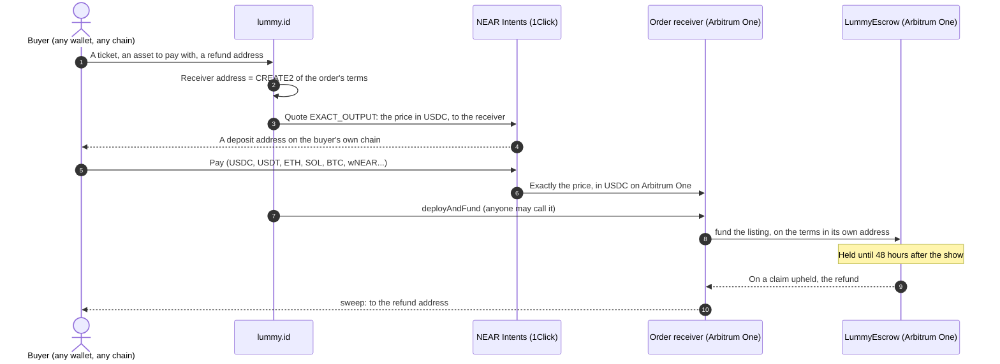
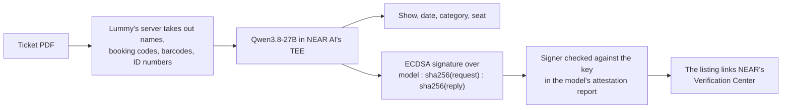
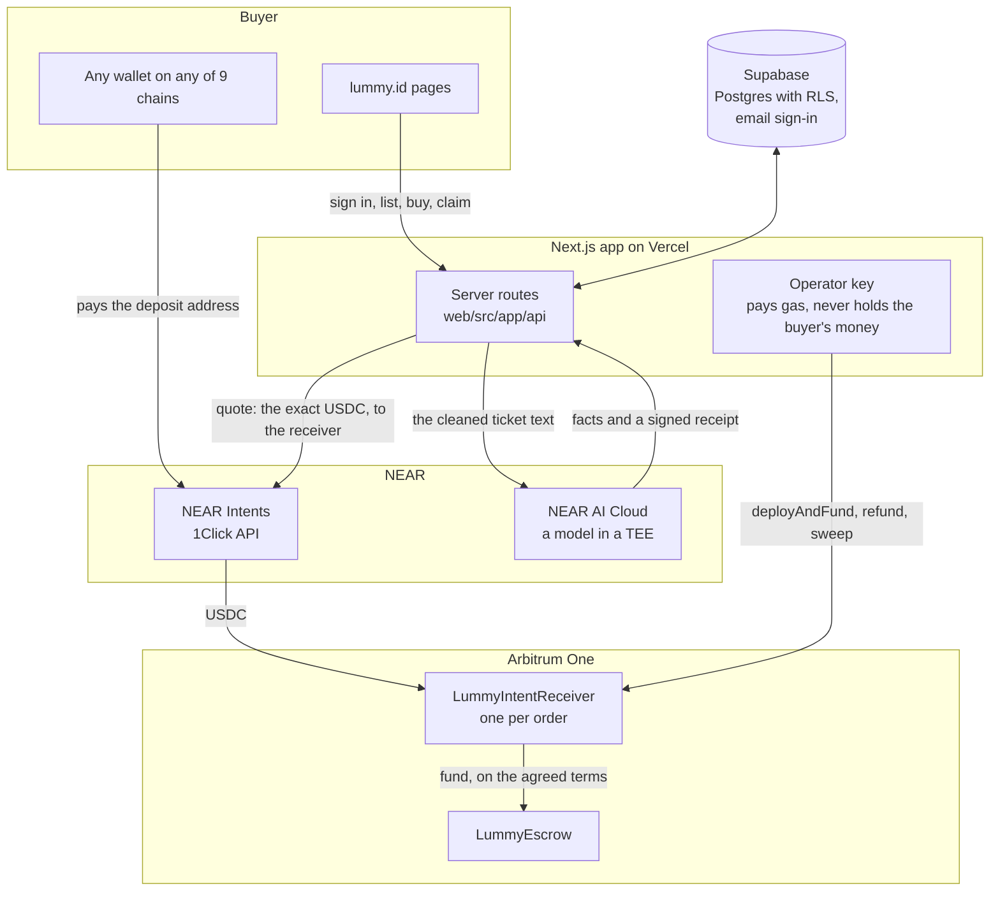
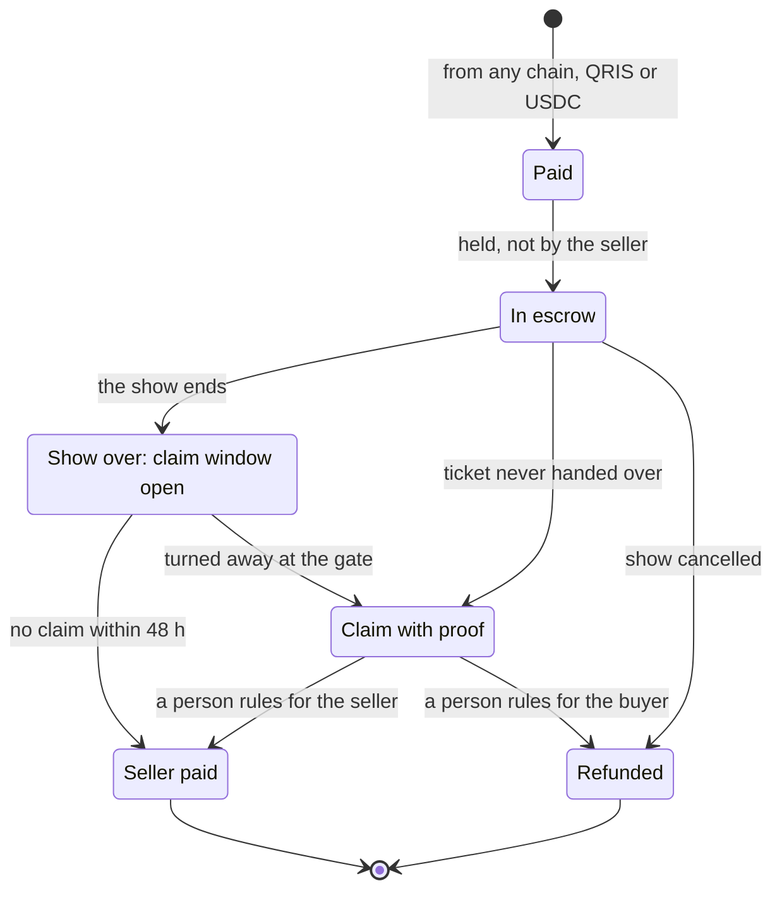

<div align="center">


### Buyer protection for resale tickets.<br>Pay from any chain through NEAR Intents, into an escrow that holds the money until the show is over.

[<kbd> <br> Try it: lummy.id/near &nbsp;→ <br> </kbd>](https://lummy.id/near)
&nbsp;
[<kbd> <br> What we built this week &nbsp;→ <br> </kbd>](https://github.com/Lummy-Ticket/lummy/compare/pre-hackathon...hackathon-submission)
&nbsp;
[<kbd> <br> The first real payment &nbsp;→ <br> </kbd>](#tried-with-real-money)
&nbsp;
[<kbd> <br> Live site &nbsp;→ <br> </kbd>](https://lummy.id)

<br>


<br>

<a href="https://lummy.id/near"></a>

</div>

> [!IMPORTANT]
> **Status (November 2026):** a working prototype, not launched. No users and no revenue yet. Real money moves only in the Lummy team's own demo payments on Arbitrum One, through contracts that are unaudited and capped at 25 USDC an order. Everyone else pays in test mode: QRIS in Xendit's test mode, USDC on Arbitrum Sepolia.

**NEAR HACKATHON entry for two tracks: Real-World Money, and Privacy & Private AI.** Lummy existed before the hackathon, and only the NEAR work is new. All of it is in [the diff between the tags `pre-hackathon` and `hackathon-submission`](https://github.com/Lummy-Ticket/lummy/compare/pre-hackathon...hackathon-submission). [What came before](#before-this-hackathon) is listed at the end.

## The problem

Resale tickets change hands between strangers. The ticket can be fake, sold twice, or never sent. Paying in crypto makes this worse: a transfer cannot be taken back, and the buyer and the seller rarely hold the same coin on the same chain.

On Lummy the buyer's money is held until 48 hours after the show, and the seller is paid only if no claim stands. Every ticket is checked before it is listed. This week we brought both to NEAR: a buyer can pay from any chain into the escrow, and the ticket check runs in a TEE with a receipt anyone can verify.

## What we built this week

### 1. Pay from any chain, into escrow (Real-World Money)

A buyer pays for a ticket to a show abroad with any of 15 assets on 9 chains: USDC on Base, Solana, Ethereum, NEAR, Optimism, Polygon or Avalanche, USDT on Solana or Ethereum, ETH, SOL, BTC or wNEAR. NEAR Intents turns it into exactly the ticket's price in USDC and delivers it on Arbitrum One to a contract made for that one order. That contract can do only two things with the money: lock it in Lummy's escrow on the agreed terms, or send it back to the buyer.



- **The terms are fixed before the buyer pays.** The receiver's address is computed with CREATE2 from the listing, the seller, the price, when the show ends, the refund address and a deadline. 1Click delivers to that address, so paying it is agreeing to those terms. The checkout shows them.
- **No key controls the buyer's money, ours included.** Every function of the receiver except `raiseDispute` is open to anyone, and it can only fund that listing on those terms or pay the refund address. If Lummy's servers were gone, the buyer could deploy the receiver and take the money back with the terms the checkout showed.
- **The escrow did not change.** To `LummyEscrow`, the receiver is a buyer with a contract wallet (EIP-1271). It approves only the escrow and USDC, and only while its own `fund()` is running.
- **Too much, or too late.** An overpayment goes back to the refund address in the same transaction. Money that arrives after the hold expired is swept back by a daily job, or by anyone.
- **Polled, not pushed.** 1Click has no webhooks, so the checkout asks for the swap's status, and the server finishes the order once the USDC is at the receiver.
- **Where it lives:** [`contracts/src/LummyIntentReceiver.sol`](contracts/src/LummyIntentReceiver.sol), [`web/src/lib/near/oneclick.ts`](web/src/lib/near/oneclick.ts), [`web/src/lib/payments/intents.ts`](web/src/lib/payments/intents.ts), [`web/src/components/checkout/IntentsPanel.tsx`](web/src/components/checkout/IntentsPanel.tsx).

#### Tried with real money

On 9 November 2026 the team paid 1.0156 USDC from a wallet on Base. Each step is public:

1. [Paid on Base](https://basescan.org/tx/0xbd2abb9fb8c13c081bdff9fb65915ccb89f888b9d40ee95c972cf2bfdf6b4ffb)
2. [The swap on NEAR Intents](https://explorer.near-intents.org/transactions/0xD646036b628353F66A796808D0f8C68cF6f72cc2). The 0.0078 USDC it did not need went back on Base.
3. [1 USDC arrived at the order's receiver on Arbitrum One](https://arbiscan.io/tx/0x3188de757fdb1d05159ba1736fe856a032eb0f81cfae5b2153859ad8e0858062), about 20 seconds after NEAR Intents saw the deposit
4. [Locked in the escrow](https://arbiscan.io/tx/0x026c74573c2cb09eec3b50d28a2bdd0128b2c53fbabd8ad566d2128b48e4684f)
5. [Refunded by the escrow](https://arbiscan.io/tx/0x4543d8cecbd3ee9736add4f66324c412c3d9342c28467423f8ee37fc343966e0)
6. [Back at the buyer's refund address](https://arbiscan.io/tx/0xef151467d037b02f731e2edce82cb44ad115ba3bc7df3272aec9cbe336e329d0)

The swap cost 0.0054 USDC. The four transactions on Arbitrum One cost about 0.000026 ETH in gas, paid by the operator.

**Check the terms yourself.** The receiver of this payment, [`0x903C…8f6A`](https://arbiscan.io/address/0x903CE1751A2F5e8034b9A14a37b9294b8Ab58f6A#readContract), shows its listing, seller, price, show end, refund address and deadline under Read Contract. Give them to the factory's [`receiverOf`](https://arbiscan.io/address/0x3dFc2bFFBfC17F1e5F741E0dCD04e8F24dd6b75C#readContract) and it returns that same address. Change any one of them, the refund address included, and the address changes: the money could only go where those terms say.

### 2. A ticket check you can verify (Privacy & Private AI)

Before a ticket is listed, a model reads the show, date, category and seat off its PDF. It fills the listing in and cross-checks what the seller picked. It decides nothing: anything that does not match goes to a person. This week that read moved into NEAR AI's TEE, and every read now comes back with a receipt anyone can check.



- **What leaves our server.** Only the ticket's text, with names, booking codes, barcode contents, ID numbers, emails and phone numbers taken out ([`clean.ts`](web/src/lib/tickets/clean.ts)). If anything that looks personal is left, nothing is sent and the seller fills the form in by hand.
- **What the TEE adds.** The text is read inside hardware-isolated, attested hardware: an Intel TDX machine whose NVIDIA GPUs run in confidential-computing mode. We say "hardware-isolated and attested", not "nobody can see it".
- **The receipt.** We hash the exact bytes sent and received, fetch the model's signature, recover its signer with viem, and require that signer to be a key named in the model's attestation report. The request names the model's canonical id with `x-no-aliasing`, so NEAR's gateway forwards it unchanged and the signature comes from the model's TEE, not from the gateway. A listing links [NEAR's Verification Center](https://cloud.near.ai/verify) only when both checks pass. The receipt holds hashes, never the ticket's text.
- **Measured before it was switched on.** On 33 made-up tickets, Qwen3.8-27B with thinking off got every field right on 29. On the other 4 it left the title blank rather than invent one: 97.8% of fields right, with a median of 2.8 seconds and 31 of 31 receipts verified. Claude Haiku 5.5, which still reads other sellers' tickets, got all 231 fields right on the same set.
- **Where it lives:** [`web/src/lib/tickets/near-ai.ts`](web/src/lib/tickets/near-ai.ts) (the call and the receipt), [`web/src/lib/tickets/ai.ts`](web/src/lib/tickets/ai.ts), [`web/src/app/near/page.tsx`](web/src/app/near/page.tsx).

<table>
<tr>
<td width="50%"><br><b>On lummy.id/near.</b> A made-up ticket read in the TEE in a few seconds, signed by the model's key, which is named in its attestation report.</td>
<td width="50%"><br><b>On NEAR's own page.</b> The same kind of receipt: the signature verified, and the hardware evidence (NVIDIA GPU, Intel TDX) verified in the browser.</td>
</tr>
</table>

NEAR's page checks NVIDIA's freshly issued GPU token with no allowance for clock difference. On a computer whose clock runs a few seconds slow it reports the GPU check as failed, while the same receipt passes in full once the clock is right. [lummy.id/near](https://lummy.id/near) says so next to the link.

## Try it in 2 minutes

| | Do this | See this |
|---|---|---|
| 1 | Open [lummy.id/near](https://lummy.id/near) and pick an asset under "Pay from any chain" | A live quote from NEAR Intents: what you would send on that chain for a 9.50 USDC ticket, and how long it usually takes. Nothing is held and nothing is paid |
| 2 | Under "A ticket check you can verify", press **Check this ticket** | A made-up ticket read in NEAR AI's TEE, "Signed by the model's TEE key", and the signer named in the attestation report |
| 3 | Press **Check it on NEAR's Verification Center** | NEAR's page verifies the same receipt and the hardware evidence in your browser |
| 4 | Press **Change one character and check again** | The changed receipt is refused |
| 5 | Open the six links under "On chain" | The first real payment, step by step, on Basescan, the NEAR Intents explorer and Arbiscan |
| 6 | Open [that payment's receiver](https://arbiscan.io/address/0x903CE1751A2F5e8034b9A14a37b9294b8Ab58f6A#readContract) on Arbiscan, then the factory's [`receiverOf`](https://arbiscan.io/address/0x3dFc2bFFBfC17F1e5F741E0dCD04e8F24dd6b75C#readContract) with the terms it shows | The same address comes back: the terms the buyer paid against are fixed in the address itself |
| 7 | Clone this repository, then run `cd web && npm ci && npm run near:check` | 39 checks pass offline, with no keys: the receipt, the Verification Center link, the 1Click request, and who may pay |

Paying for real through NEAR Intents is open to the Lummy team's accounts only, so a visitor sees the quote but no deposit address.

## How we checked it

| Check | What it covers | Result |
|---|---|---|
| `npm run near:check` (in CI) | Offline, no keys. A real ECDSA signature over `model:request_hash:response_hash` passes, and a changed hash, model, signer, text or kind of signature fails. The Verification Center link carries no ticket text. A listing links a receipt only when it was verified and attested. The 1Click request asks for the exact amount at the receiver, with refunds on the chain paid from. Only staff and the named team may pay, never a demo account | 39 of 39 |
| `forge test` in `contracts/` | The new receiver and its factory (33 tests: the two exits, the terms checked against the escrow, overpayment, late money, EIP-1271 only inside `fund`, fuzzing), plus the escrow and ledger from before | 147 of 147. The receiver: 100% of lines and functions, 91.7% of branches |
| `RUN_FORK=1 forge test --match-contract Fork` | The receiver against Circle's real USDC on a fork of Arbitrum One | 2 of 2 |
| `npm run near:fork` | The chain side through the app's own code, on that fork: a payment with too much, a release to the seller, a claim refunded through the receiver, money with no order going back by itself | 13 of 13 |
| `npm run near:app` | The whole app flow: a local server, the real 1Click API, the database and the fork. A hold and a cancel, an overpayment, one order however often it is checked, a claim refunded to the refund address | 22 of 22 |
| `npm run near:pay` | One real payment from another chain into the escrow on Arbitrum One and back | [Done 9 Nov 2026](#tried-with-real-money) |
| `npm run ai:eval -- --provider near` | 33 made-up tickets, each through the same cleaning as a real upload, then the TEE model; every request checked for names, numbers and codes that should have been taken out | 29 of 33 tickets, 97.8% of fields, 31 of 31 receipts |
| Slither (Trail of Bits), in CI | The new receiver triaged with the rest in [`contracts/SECURITY-ANALYSIS.md`](contracts/SECURITY-ANALYSIS.md). CI fails on any untriaged medium or high finding | 21 new findings triaged, none a real issue |

Anyone can run `near:check` and `forge test`. The fork, app and payment runs need our keys, Foundry or the database, so the team runs them; the results above are from 9 November 2026.

## Contracts

**On Arbitrum One (chain ID 42161), new this week**

| Contract | Address | What it does |
|---|---|---|
| `LummyEscrow` | [`0x68d535494bf33a6F483A945683Ab629D036d3cb3`](https://arbiscan.io/address/0x68d535494bf33a6F483A945683Ab629D036d3cb3#code) | The same escrow as on Arbitrum Sepolia, deployed fresh: Circle's USDC, a 48-hour claim window after the show, at most 25 USDC an order |
| `LummyIntentFactory` | [`0x3dFc2bFFBfC17F1e5F741E0dCD04e8F24dd6b75C`](https://arbiscan.io/address/0x3dFc2bFFBfC17F1e5F741E0dCD04e8F24dd6b75C#code) | Computes each order's `LummyIntentReceiver` address, and deploys and funds it |

Both have verified source on Arbiscan and are not proxies. Neither takes a fee. Money in the escrow can only go to a listing's buyer or seller, and money at a receiver only into its listing or back to its refund address.

**On Arbitrum Sepolia (chain ID 421614), from before the hackathon:** [`LummyEscrow`](https://sepolia.arbiscan.io/address/0x6830Db86283157E4cB80b0615d4c51381A0C25Dd#code) with test USDC, and [`LummyLedger`](https://sepolia.arbiscan.io/address/0xe454cbc81916E9BE1e6A768715134568FCEE8b0E#code), the public record of QRIS orders. Details: [`contracts/README.md`](contracts/README.md).

## Architecture



The database decides; the chain holds the money. Tickets stay off chain: they are the organiser's PDFs, not NFTs.

**Why the escrow stays on Arbitrum.** It was already built and tested there: Circle's native USDC with ERC-3009, the escrow's own 76 tests with fuzzing and invariant runs, and a testnet deployment the app has used since October. NEAR Intents delivers to any chain, so it brings the money to the escrow from 9 chains, NEAR itself included, without moving the escrow. Rewriting it as a NEAR contract in Rust this week would have meant shipping an untested escrow.

## How an order settles



A ruling can also split the money. The clock settles an order, not a button: there is no "I got in" confirmation to fake. A refund on an order paid from another chain goes to the refund address the buyer gave before paying, as USDC on Arbitrum One.

## Before this hackathon

Everything before the tag `pre-hackathon` (9 November 2026) existed already and is not part of this entry:

- **Lummy, since July 2026:** escrow for concert ticket resale in Indonesia. Rupiah by QRIS through Xendit in test mode: the licensed provider holds the money until the show, and every paid order is recorded on `LummyLedger`. Ticket checks: each barcode held by one listing only, edited PDFs sent to a person, the show and seat read by Claude after personal data is taken out. Claims ruled by a person.
- **Arbitrum Founder House Singapore, 23 to 25 October 2026:** we added the checkout for shows abroad, in test USDC from the buyer's own wallet, into `LummyEscrow` on Arbitrum Sepolia. We submitted it, and were not a finalist. The tag `founder-house-start` marks where that work began, and the [demo video from then](https://youtu.be/090tOYfTQ4I) shows the product as it was.

<details>
<summary><b>Screens of the product</b></summary>

<table>
<tr>
<td width="50%"><br><b>Every ticket is checked first.</b> An edited sample PDF is flagged for a person; a barcode already on sale is refused.</td>
<td width="50%"><br><b>The money waits for the show.</b> The order page shows where the money is, when it pays out, and the handover documents.</td>
</tr>
<tr>
<td><br><b>Every paid order is a public record.</b> The proof page reads LummyLedger on Arbitrum: paid, claimed, ruled, refunded.</td>
<td><br><b>A person rules on claims.</b> The evidence checks are signals for staff, not verdicts.</td>
</tr>
</table>

</details>

## Built with

- **App:** Next.js 16 and TypeScript on Vercel, Supabase (Postgres with row-level security, email sign-in), viem.
- **Contracts:** Solidity 0.8.28 with Foundry and OpenZeppelin, Circle's USDC, Slither in CI.
- **NEAR:** NEAR Intents through the 1Click API (quote, deposit, status). NEAR AI Cloud: Qwen3.8-27B in a TEE, its signature endpoint and its attestation report.
- **AI tools:** most of the code was written with Claude Code (Anthropic), directed and reviewed by the team, and Claude drafted this README. Claude Haiku 5.5 reads tickets for sellers outside the team.

## Not done yet

- Real payments through NEAR Intents are for the team's accounts only, at most 25 USDC an order. The contracts are unaudited.
- On Arbitrum One the seller's share goes to a team wallet: sellers sign in with an email and have no wallet yet.
- The listings on shows abroad are the team's samples.
- The TEE read runs for the team's accounts. Other sellers' tickets are still read by Claude Haiku, after the same cleaning.
- NEAR AI's response times vary: 1 to 8 seconds this week, with the odd stall of 20 to 30 seconds. A try is cut at 12 seconds and sent again.
- There is no NEAR smart contract. NEAR is how the money arrives and where the ticket is read.

<details>
<summary><b>Repo map</b></summary>

| Path | What it is |
|---|---|
| [`web/`](web) | The Next.js app in TypeScript: buyer, seller and staff pages |
| [`web/src/lib/near`](web/src/lib/near) | NEAR Intents (1Click), who may pay, the made-up tickets for /near |
| [`web/src/lib/tickets`](web/src/lib/tickets) | The ticket checks: barcodes, the cleaner, the AI step, the NEAR AI call and its receipt |
| [`web/src/lib/payments`](web/src/lib/payments) | Payments from any chain, QRIS through Xendit, and the USDC checkout |
| [`web/src/lib/chain`](web/src/lib/chain) | Contract access with viem, on the server and in the browser |
| [`web/src/app/api`](web/src/app/api) | Server routes: listings, orders, payments, claims, the ticket checks, /near |
| [`web/scripts`](web/scripts) | The checks above, and the local and fork rehearsals |
| [`contracts/`](contracts) | Solidity and Foundry: `LummyEscrow`, `LummyLedger`, `LummyIntentReceiver`, tests, deploy scripts |
| [`supabase/`](supabase) | The Postgres schema, row-level security and its tests, email templates |

</details>

<details>
<summary><b>Run it locally</b></summary>

Node 22 and [Foundry](https://www.getfoundry.sh). Each line runs from the repository root:

```bash
cd web && npm ci && npm run near:check    # the NEAR checks, offline
cd contracts && git submodule update --init --recursive && forge test
cd web && npm run dev                     # the app on localhost:3000, on sample data
cd web && npm run chain:local             # Anvil, a deploy, and four escrow cycles
```

Without environment variables the app runs on its sample catalogue and sample accounts. [`web/.env.example`](web/.env.example) lists what a deploy sets, the NEAR keys included. Code comments are in English and Indonesian.

</details>

> [!NOTE]
> This repository is a public mirror of our working repository. It holds the app, the database schema and the contracts, with their full commit history. Internal notes, plans and partner documents stay private, so a few links in code comments and commit messages point to files that are not here.

## Team and contact

- Zahra Sasongko, CEO
- Luthfi Hadi, CTO ([@luthfidi](https://github.com/luthfidi))
- Joanita Timbin Panggalo, COO

Contact: [team@lummy.id](mailto:team@lummy.id). More at [github.com/Lummy-Ticket](https://github.com/Lummy-Ticket).

## License

All rights reserved: see [LICENSE](LICENSE). You may read the code and run its checks to judge this entry. For anything else, write to [team@lummy.id](mailto:team@lummy.id).
