<div align="center">


### Escrow for concert ticket resale in Indonesia.<br>The seller gets paid only after the show.

[<kbd> <br> Watch the demo (2:50) &nbsp;→ <br> </kbd>](https://youtu.be/090tOYfTQ4I)
&nbsp;
[<kbd> <br> Live site &nbsp;→ <br> </kbd>](https://lummy.id)
&nbsp;
[<kbd> <br> Try a demo account &nbsp;→ <br> </kbd>](https://lummy.id/login#demo)
&nbsp;
[<kbd> <br> How it works &nbsp;→ <br> </kbd>](https://lummy.id/how-it-works)
&nbsp;
[<kbd> <br> Built at Founder House &nbsp;→ <br> </kbd>](https://github.com/Lummy-Ticket/lummy/compare/founder-house-start...main)

<br>


<br>

<a href="https://lummy.id">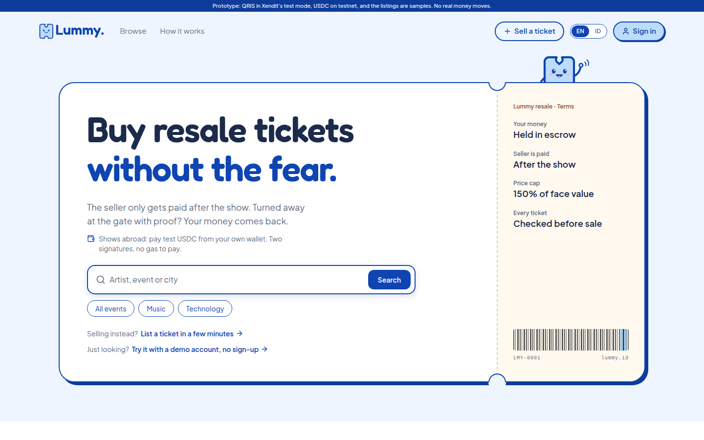</a>

</div>

> [!IMPORTANT]
> **Status (October 2026):** a working prototype. USDC is test USDC on Arbitrum Sepolia, QRIS runs in Xendit's test mode, so no real money moves. Not launched: no users and no revenue yet. Every listing on the site is a sample.

**Demo video (2:50):** [youtu.be/090tOYfTQ4I](https://youtu.be/090tOYfTQ4I). A seller's ticket checked, a QRIS order recorded on Arbitrum, a claim and its ruling, and the USDC checkout from a real browser wallet.

**Pitch deck:** [canva.link/z2vv4sv33mrfg9t](https://canva.link/z2vv4sv33mrfg9t), two slides: the problem, how Lummy works, the model, traction and the ask.

## What it does

<p align="center">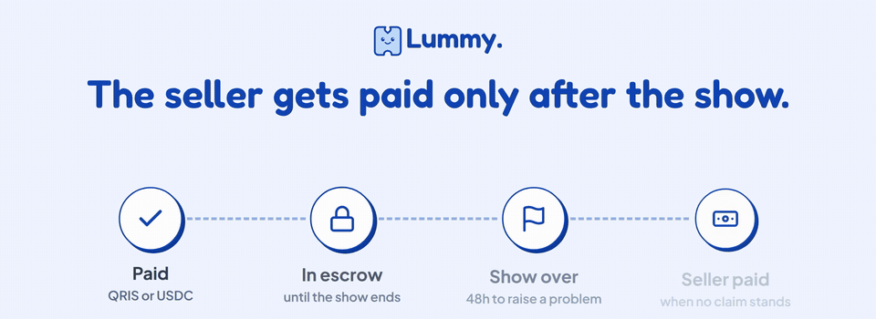</p>

- **The money waits for the show.** The buyer's money is held until 48 hours after the show (10 minutes on the testnet escrow, so a demo can run to the end). No claim, and the seller is paid. Turned away at the gate with proof, and the buyer gets it back.
- **Every ticket is checked before it is listed.** Each barcode is read and stored as a keyed hash, so a barcode can be sold only once. Edited PDFs are flagged for a person. Claude reads the show, category and seat from the ticket text after personal data is taken out; it fills in details and does not judge.
- **Two payment rails, one public record.** Shows in Indonesia: rupiah by QRIS through Xendit, a licensed provider, with every paid order recorded on **LummyLedger**. Shows abroad: USDC from the buyer's own wallet, locked per listing in **LummyEscrow**, with two signatures and no gas.
- **Email sign-in.** A wallet only appears when paying for a show abroad. Tickets are not NFTs, and Lummy stores no ID cards.

## Try it in 2 minutes

| | What to do | What you need |
|---|---|---|
| 1 | **No sign-up:** open [lummy.id/login#demo](https://lummy.id/login#demo) (or "Try it with a demo account" on the home page) and pick a role. **Buyer:** buy a ticket and press Pay (the payment is simulated), then open the ticket page and the letter of authorisation. **Seller:** "Sell a ticket", pick a sample ticket (each can be downloaded as a PDF) and see the checks: a genuine one goes live, an edited one waits for a person, a duplicate barcode is refused. **Admin:** rule on a sample claim. | Nothing. Demo accounts keep their orders in your browser, and their checks are simulated from the samples |
| 2 | **A real public record:** [an example QRIS test order](https://lummy.id/proof/0x92b4028867b6babeb33c6f262bdbdb04f2396faf067b57d31a9acf6778948691) with a payment, a claim and a full-refund ruling, read straight from LummyLedger, with Arbiscan links. | Nothing |
| 3 | **QRIS in test mode:** sign in with your email, buy on a show in Indonesia such as [5 Seconds of Summer, Jakarta](https://lummy.id/events/ev-5sos-jakarta), press "Simulate payment (test mode)", then open the order's public proof page. | An email |
| 4 | **USDC from your wallet** (the work from Founder House): open [Binance Blockchain Week](https://lummy.id/events/ev-bbw-2026), choose "USDC from your wallet", connect, then sign twice. The Early Bird sample listings cost 9.50 test USDC. | An email, and a browser wallet with test USDC from [faucet.circle.com](https://faucet.circle.com) (choose Arbitrum Sepolia; no ETH needed) |

The test QRIS code cannot be paid by a real banking app, and the test USDC has no value. What we do and do not promise: [lummy.id/how-it-works](https://lummy.id/how-it-works).

## Screens

<table>
<tr>
<td width="50%">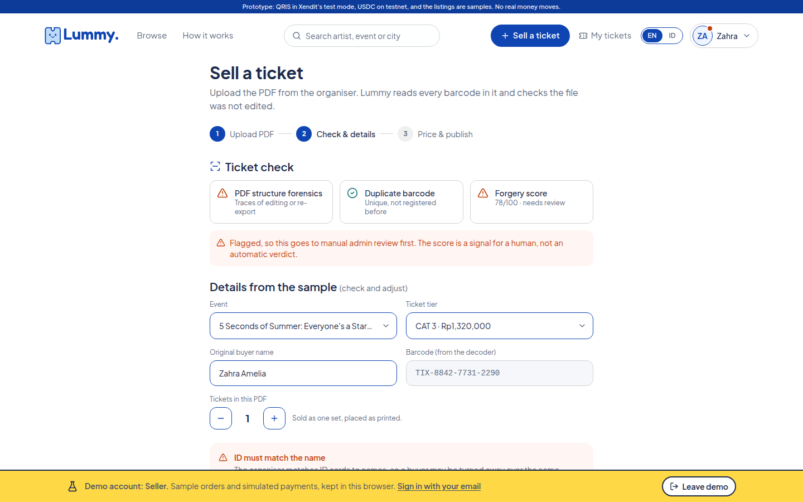<br><b>Every ticket is checked first.</b> An edited sample PDF is flagged for a person; a barcode already on sale is refused.</td>
<td width="50%">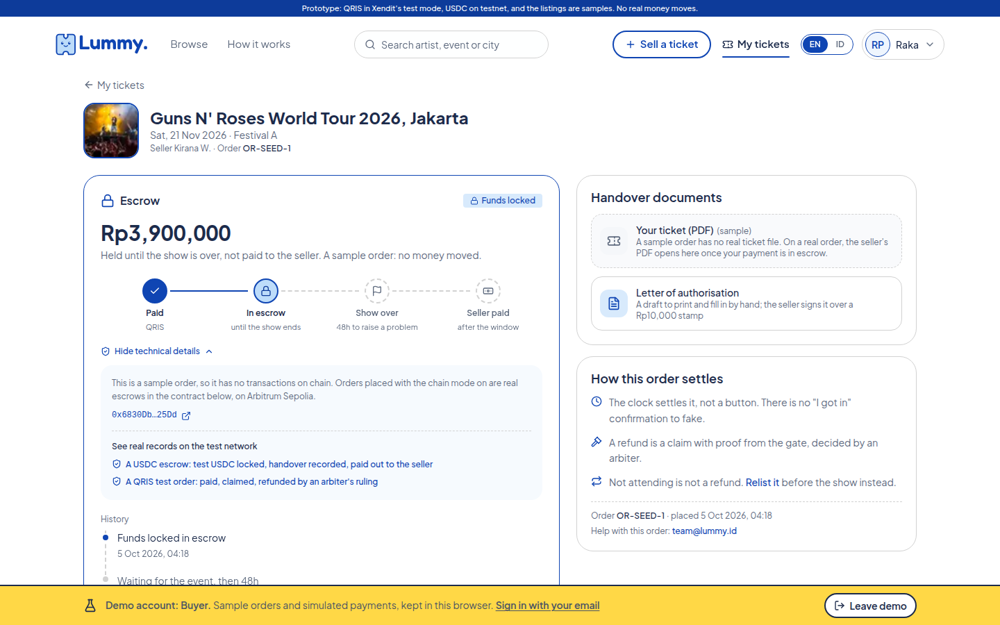<br><b>The money waits for the show.</b> The order page shows where the money is, when it pays out, and the handover documents.</td>
</tr>
<tr>
<td>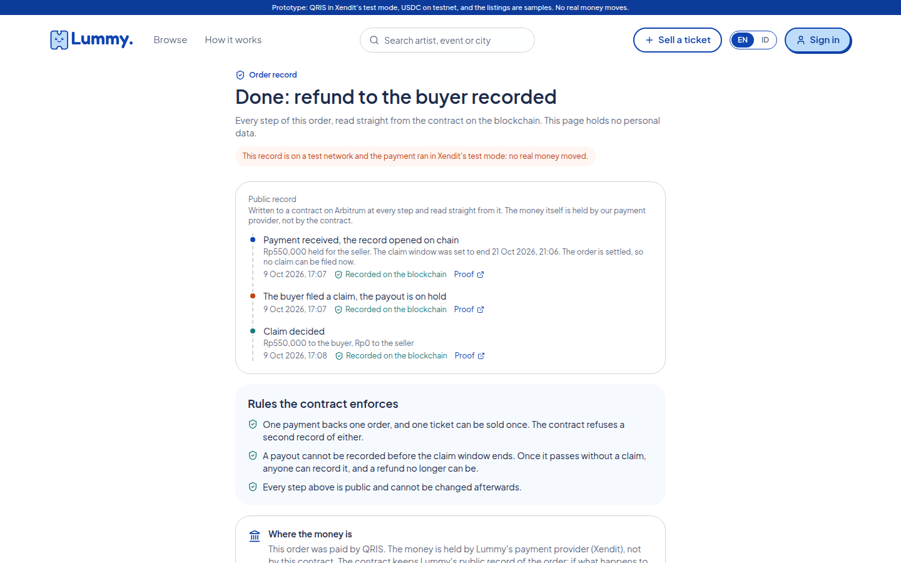<br><b>Every paid order is a public record.</b> The proof page reads LummyLedger on Arbitrum: paid, claimed, ruled, refunded.</td>
<td>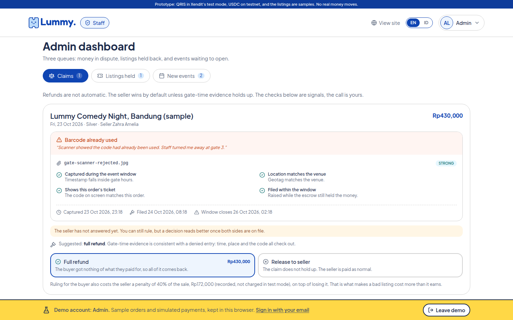<br><b>A person rules on claims.</b> The evidence checks are signals for staff, not verdicts.</td>
</tr>
<tr>
<td>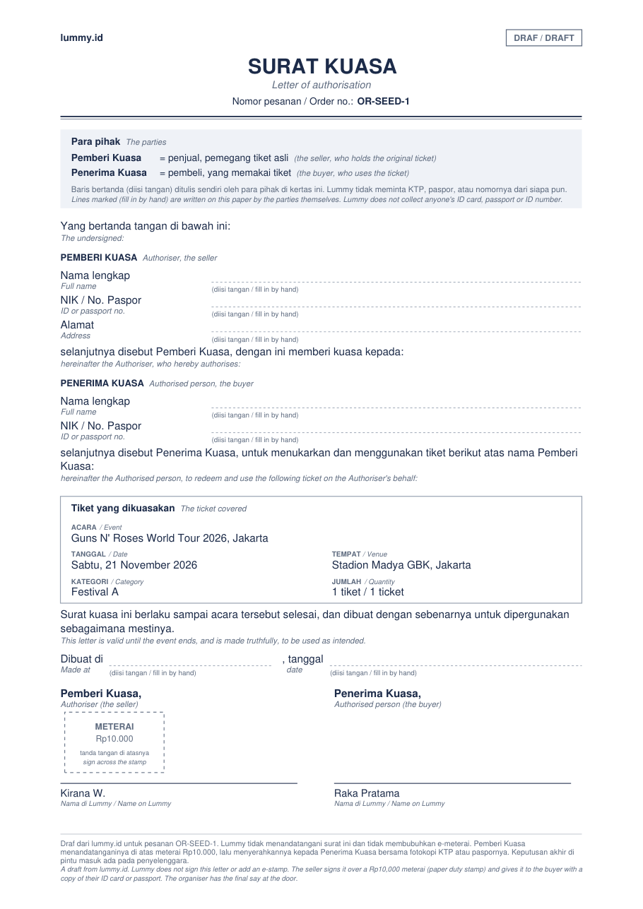<br><b>A letter of authorisation, in two languages.</b> For shows that check names: filled in by hand, NIK or passport number, signed over a meterai. Lummy keeps no ID data.</td>
<td>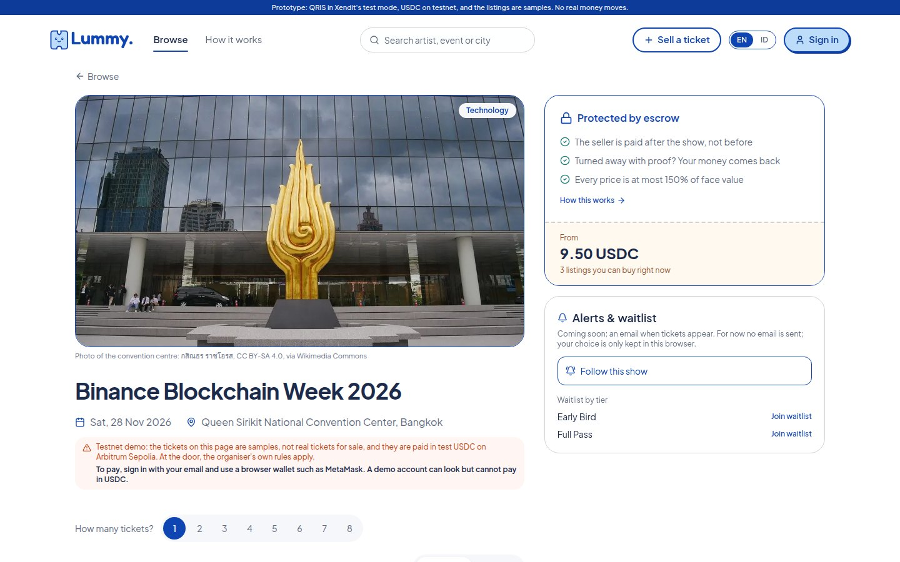<br><b>Shows abroad take USDC.</b> From the buyer's own wallet, with two signatures and no gas, labelled as a testnet demo.</td>
</tr>
</table>

## Built at Arbitrum Founder House

The git tag `founder-house-start` marks the start of Arbitrum Founder House Singapore (set on 23 October 2026, before doors opened; in this mirror it points at the last code commit before the event). Everything before it existed already. The work done at the event: `git log founder-house-start..HEAD`, or on GitHub, [compare `founder-house-start...main`](https://github.com/Lummy-Ticket/lummy/compare/founder-house-start...main).

**What we built: USDC checkout from the buyer's own wallet, for shows abroad.**

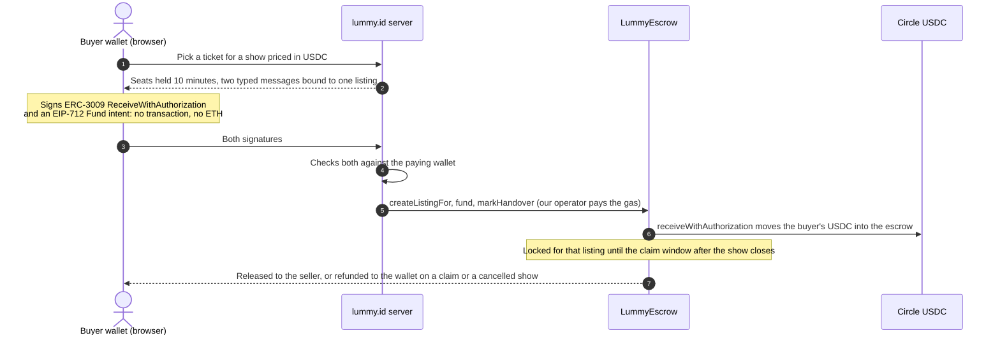

- **Guards:** a "Testnet, not real money" label, sign-in required, at most 3 open USDC orders per wallet, a rate limit per account, and a switch that turns the rail off without a deploy. If the order cannot be written after funding, the USDC goes straight back to the wallet on chain.
- **Where it lives:** [`web/src/lib/payments/usdc.ts`](web/src/lib/payments/usdc.ts) (server), [`web/src/components/checkout/UsdcPanel.tsx`](web/src/components/checkout/UsdcPanel.tsx) and [`web/src/lib/chain/wallet.ts`](web/src/lib/chain/wallet.ts) (wallet side). The contract source did not change: it was built for this.
- **Limits today:** the seller's USDC payout goes to a simulated seller address, because sellers have no wallet yet in our email-first model. Listing a ticket for a USDC show is closed for now; the sample listings were added by the team. There is no service fee on USDC orders while they run on testnet.
- **Tried with a real wallet:** on 24 Oct 2026 (UTC) a 9.5 test USDC purchase from a Rabby wallet, with two signatures. The wallet sent no transaction and paid no gas: [the funding transaction on Arbiscan](https://sepolia.arbiscan.io/tx/0x16fbe1ca8519c97e7458848f052e9d6f6edc16943d345ccb0fc7fbe0f847abed).

Also at the event: claims and rulings on USDC orders end to end, Slither (Trail of Bits) on both contracts in CI, Quicknode as our RPC, a real show catalogue, stricter ticket checks (a holder's name never reaches the AI, tickets marked TEST or VOID go to a person), a demo-account link on the home page, and sample ticket PDFs so anyone can try the checks.

## How an order settles

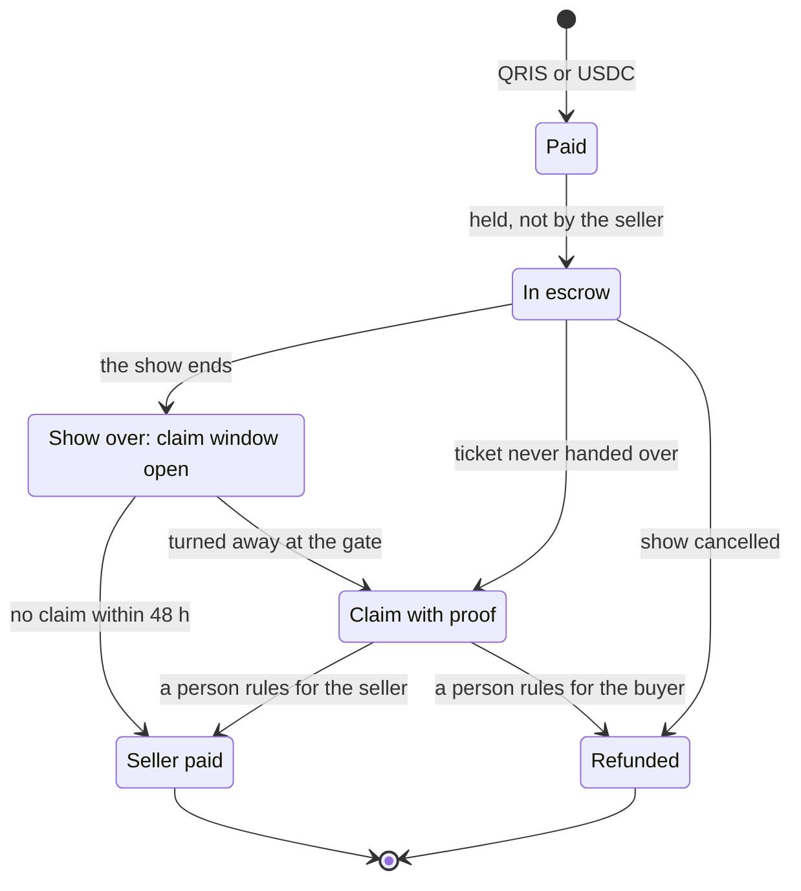

A ruling can also split the money. A postponed show lets the buyer keep the ticket or take the money back. The clock settles an order, not a button: there is no "I got in" confirmation to fake.

## Contracts on Arbitrum Sepolia (chain ID 421614)

| Contract | Address | What it does |
|---|---|---|
| `LummyEscrow` | [`0x6830Db86283157E4cB80b0615d4c51381A0C25Dd`](https://sepolia.arbiscan.io/address/0x6830Db86283157E4cB80b0615d4c51381A0C25Dd#code) | Holds a buyer's USDC per listing until the claim window after the show closes (10 minutes on this testnet deployment, 48 hours on Arbitrum One), then pays the seller, refunds the buyer, or splits on a ruling. Once the window passes, anyone can release it to the seller, even with our backend down |
| `LummyLedger` | [`0xe454cbc81916E9bE1e6A768715134568FCEE8b0E`](https://sepolia.arbiscan.io/address/0xe454cbc81916E9bE1e6A768715134568FCEE8b0E#code) | Records each rupiah (QRIS) order's life on chain: paid, claim, ruling, payout, refund. It holds no money |
| USDC (Circle) | [`0x75faf114eafb1BDbe2F0316DF893fd58CE46AA4d`](https://sepolia.arbiscan.io/token/0x75faf114eafb1BDbe2F0316DF893fd58CE46AA4d) | Circle's native USDC on Arbitrum Sepolia, not a mock. Its ERC-3009 support is what lets the buyer pay with signatures only |

Both Lummy contracts have verified source on Arbiscan and Sourcify, are not proxies, take no fee, and have no way to sweep funds: money can only go to a listing's buyer or seller. Both refuse a ticket barcode commitment that was already sold. Details: [`contracts/README.md`](contracts/README.md).

## Architecture

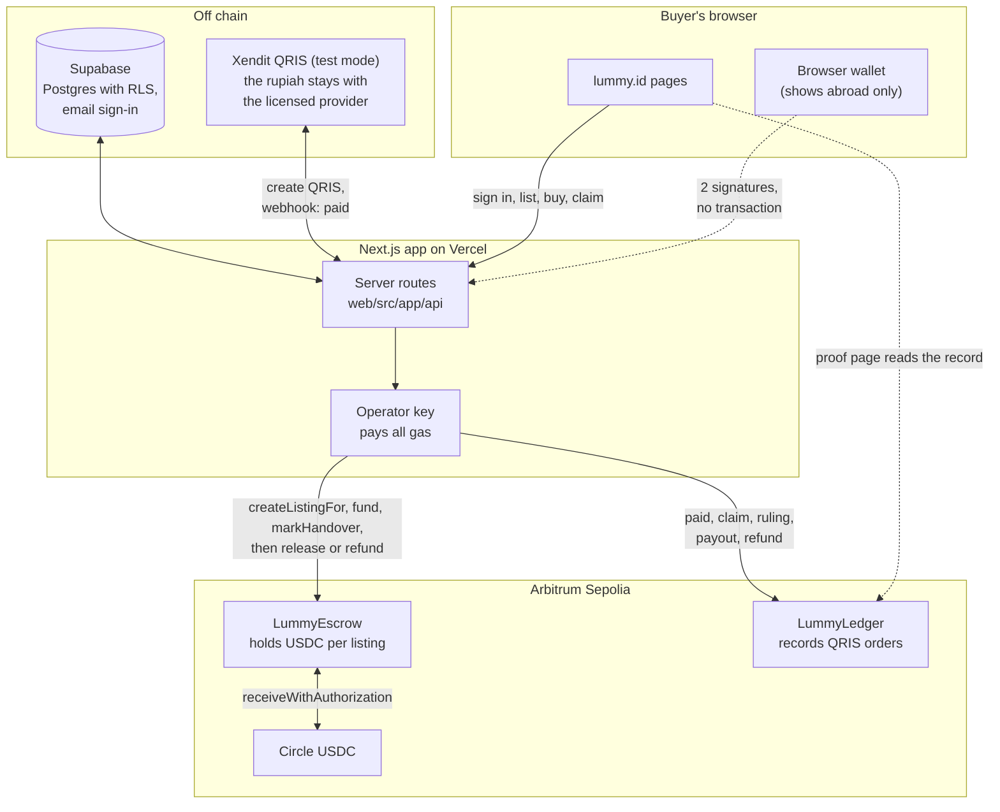

The database decides; the chain holds the money or keeps the record. Tickets, ID cards and rupiah stay off chain.

**Why on chain, and why Arbitrum**

- **The money rules do not depend on trusting us.** USDC sits in LummyEscrow, not with us, and anyone can release it to the seller once the claim window closes.
- **Every paid order is a public record.** Buyers, sellers and promoters can check it on the proof page and on Arbiscan. In Indonesia crypto may not be used as payment, so there the rupiah stays with Xendit and the chain only records.
- **Arbitrum:** Circle's native USDC with ERC-3009 (gasless for the buyer), settlement to Ethereum, and gas low enough to record every step of every order (one escrow cycle used 370,000 to 520,000 gas; we estimated about Rp400 to Rp800 per order on Arbitrum One in September 2026).

## How we check it

| Suite | What it covers | Last result |
|---|---|---|
| `forge test` in `contracts/` | Both contracts: the six escrow outcomes, the claim window, signatures, barcode commitments, access, reentrancy, plus fuzzing and invariant runs (the escrow balance always equals its books, the operator never receives funds) | 114 of 114 pass |
| `npm run usdc:check` | The USDC checkout end to end on Arbitrum Sepolia: forged signatures, another account sending the buyer's signatures, the wallet paying exactly the price, the listing funded on chain by that wallet, a purchase through the pages with a wallet injected into the browser, a cancelled show that refunds the wallet in full, and claims on USDC orders with a full or a partial ruling | 57 of 57 pass |
| `npm run payments:check` | QRIS in Xendit's test mode end to end: one order per payment however often the webhook arrives, forged webhooks refused, seats given back on cancel or expiry, the order, a claim and a ruling recorded on LummyLedger, and a cancelled show refunded on the record | 62 of 62 pass |
| Slither (Trail of Bits), in CI on every contract change | Both contracts, twice: as deployed, and with an analysis-only copy of one OpenZeppelin guard that Slither 0.11.6 cannot parse. Every finding is triaged in [`contracts/SECURITY-ANALYSIS.md`](contracts/SECURITY-ANALYSIS.md); CI fails on any untriaged medium or high finding | 12 findings triaged, none a real medium or high |

Also: row-level security tests in [`supabase/tests`](supabase/tests), Playwright browser tests in [`web/e2e`](web/e2e), and more scripted checks in [`web/scripts`](web/scripts). Anyone can run `forge test`. The `usdc:check` and `payments:check` runs need our testnet keys and database, so the team runs them; the results above are from 25 October 2026.

<details>
<summary><b>Repo map</b></summary>

| Path | What it is |
|---|---|
| [`web/`](web) | The Next.js app in TypeScript: buyer, seller and staff pages |
| [`web/src/app/api`](web/src/app/api) | Server routes: listings, orders, QRIS and USDC payments, claims, the gate, the ticket checks |
| [`web/src/lib/payments`](web/src/lib/payments) | QRIS through Xendit, and the USDC checkout |
| [`web/src/lib/chain`](web/src/lib/chain) | Contract access with viem, on the server and in the browser |
| [`web/scripts`](web/scripts) | The end-to-end checks and the local chain cycles |
| [`contracts/`](contracts) | Solidity and Foundry: `LummyEscrow`, `LummyLedger`, tests, deploy scripts |
| [`supabase/`](supabase) | The Postgres schema, row-level security and its tests, seed data, email templates |

</details>

<details>
<summary><b>Run it locally</b></summary>

Node 22 and [Foundry](https://www.getfoundry.sh). Each line runs from the repository root:

```bash
cd web && npm install && npm run dev      # the app on localhost:3000, on sample data
cd contracts && git submodule update --init --recursive && forge test
cd web && npm run chain:local             # Anvil, a deploy, and four escrow cycles: release, refund, dispute, a show tomorrow
cd web && npm run chain:fork              # a rehearsal on an Arbitrum Sepolia fork with Circle's USDC, no faucet
```

Without environment variables the app runs on its sample catalogue and sample accounts. [`web/.env.example`](web/.env.example) lists what a deploy sets (Supabase, Xendit, the operator key, the AI provider). Code comments are in English and Indonesian.

</details>

> [!NOTE]
> This repository is a public mirror of our working repository. It holds the app, the database schema and the contracts, with their full commit history. Internal notes, plans and partner documents stay private, so a few links in code comments and commit messages point to files that are not here.

## Team and contact

- Zahra Sasongko, CEO
- Luthfi Hadi, CTO ([@luthfidi](https://github.com/luthfidi))
- Joanita Timbin Panggalo, COO

Contact: [team@lummy.id](mailto:team@lummy.id). Concert news: [@lummy.magazine](https://www.instagram.com/lummy.magazine/) on Instagram. More at [github.com/Lummy-Ticket](https://github.com/Lummy-Ticket).

## License

All rights reserved. The code is public to read, not licensed for reuse.
