<div align="center">


### Buyer protection for resale tickets.<br>Pay from any chain through NEAR Intents, into an escrow that holds the money until the show is over.

[<kbd> <br> Try it: lummy.id/near &nbsp;→ <br> </kbd>](https://lummy.id/near)
&nbsp;
[<kbd> <br> What we built this week &nbsp;→ <br> </kbd>](https://github.com/Lummy-Ticket/lummy/compare/pre-hackathon...main)
&nbsp;
[<kbd> <br> The first real payment &nbsp;→ <br> </kbd>](#tried-with-real-money)
&nbsp;
[<kbd> <br> Live site &nbsp;→ <br> </kbd>](https://lummy.id)

<br>


[](https://github.com/Lummy-Ticket/lummy/actions/workflows/checks.yml)

<br>

<a href="https://lummy.id/near">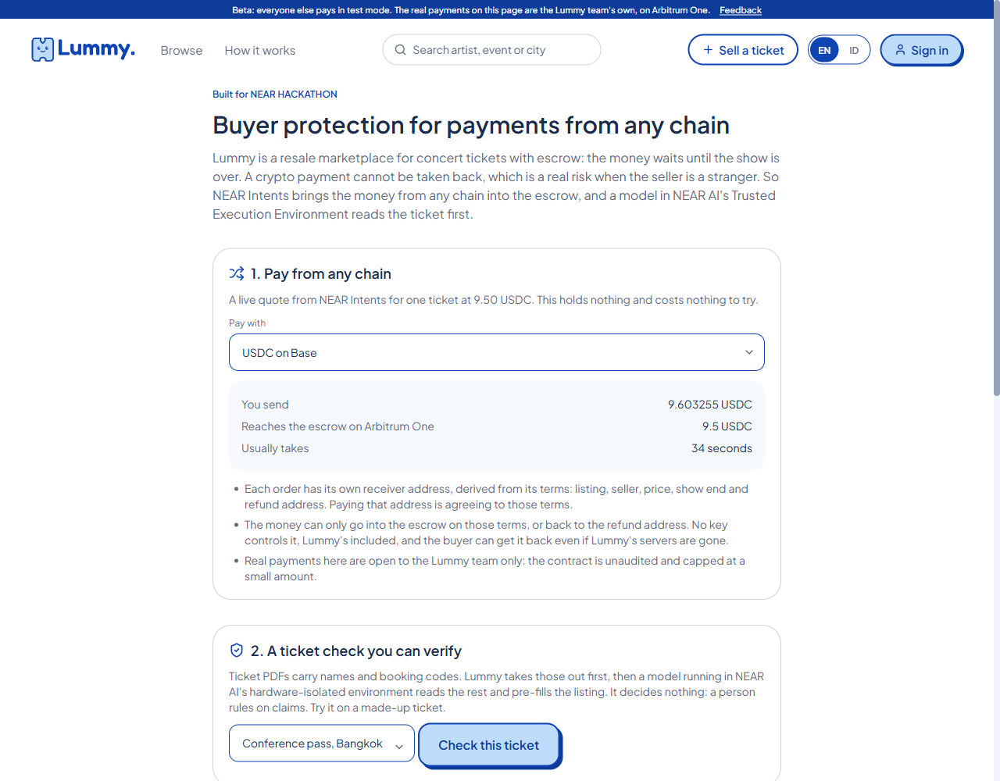</a>

</div>

> [!IMPORTANT]
> **Status (November 2026):** a working prototype, not launched. No users and no revenue yet. Real money moves only in the Lummy team's own demo payments on Arbitrum One, through contracts that are unaudited and capped at 25 USDC an order. Everyone else pays in test mode: QRIS in Xendit's test mode, USDC on Arbitrum Sepolia.

**NEAR HACKATHON entry for Real-World Money and for Privacy & Private AI, entered in Open Innovation as well** (there, for one idea: an order's terms are the address the money is sent to, so a payment from another chain can only end in that order's escrow or back with the buyer). Lummy existed before the hackathon, and only the NEAR work is new. All of it is in [the diff since the tag `pre-hackathon`](https://github.com/Lummy-Ticket/lummy/compare/pre-hackathon...main). [What came before](#before-this-hackathon) is listed at the end.

## The problem

Resale tickets change hands between strangers. The ticket can be fake, sold twice, or never sent. Paying in crypto makes this worse: a transfer cannot be taken back, and the buyer and the seller rarely hold the same coin on the same chain.

On Lummy the buyer's money is held until 48 hours after the show, and the seller is paid only if no claim stands. Every ticket is checked before it is listed. This week we brought both to NEAR: a buyer can pay from any chain into the escrow, and the ticket check runs in a TEE with a receipt anyone can verify.

## What we built this week

### 1. Pay from any chain, into escrow (Real-World Money)

A buyer pays for a ticket to a show abroad with any of 15 assets on 9 chains: USDC on Base, Solana, Ethereum, NEAR, Optimism, Polygon or Avalanche, USDT on Solana or Ethereum, ETH, SOL, BTC or wNEAR. NEAR Intents turns it into exactly the ticket's price in USDC and delivers it on Arbitrum One to a contract made for that one order. That contract can do only two things with the money: lock it in Lummy's escrow on the agreed terms, or send it back to the buyer.

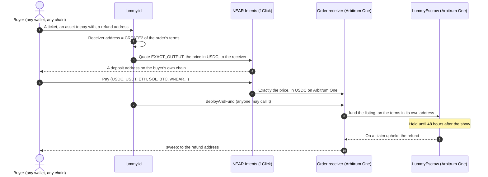

- **The terms are fixed before the buyer pays.** The receiver's address is computed with CREATE2 from the listing, the seller, the price, when the show ends, the refund address and a deadline. 1Click delivers to that address, so paying it is agreeing to those terms. The checkout shows them.
- **No key controls the buyer's money, ours included.** Every function of the receiver except `raiseDispute` is open to anyone, and it can only fund that listing on those terms or pay the refund address. If Lummy's servers were gone, the buyer could deploy the receiver and take the money back with the terms the checkout showed.
- **The escrow did not change.** To `LummyEscrow`, the receiver is a buyer with a contract wallet (EIP-1271). It approves only the escrow and USDC, and only while its own `fund()` is running.
- **Too much, or too late.** An overpayment goes back to the refund address in the same transaction. Money still at a receiver after its deadline is sent back by that same job within minutes, or by anyone.
- **Finished by the server, not by the buyer's tab.** 1Click has no webhooks, so someone has to ask how the swap is going. The buyer's page asks while it is open, and a job on the server asks every minute ([`api/cron/intents`](web/src/app/api/cron/intents/route.ts)): once the USDC is at the receiver the escrow is funded and the order written, whether or not the page is still open, and an email says so. Both go through one lock, so an order is funded once. Until 11 November only the page asked; in our own run the buyer wondered what would happen if they closed it.
- **Paid by hand, so guarded against paying twice.** A hold whose money is already on its way (1Click has seen a deposit, or USDC sits at the receiver) cannot be cancelled or replaced by a new payment, and a payment left open is shown again when the buyer comes back, with a warning not to send it twice.
- **The wallet is read before the buyer chooses.** With a browser wallet connected, the server reads what it holds of the nine EVM assets on six chains (one batched call a chain, about 3 seconds), asks 1Click what this order would take of each, and the checkout lists them: enough, how much is missing, or no gas on that chain. What can pay is picked, a stablecoin before a coin whose price moves and Ethereum last. The refund address is filled in from the wallet, and the buyer confirms one transfer there. The deposit address and its QR stay, for Solana, Bitcoin, NEAR and exchanges. We added this on 11 November after our own run, where the buyer picked ETH while holding USDC and pasted the address by hand ([`held.ts`](web/src/lib/near/held.ts), [`balances.ts`](web/src/lib/near/balances.ts)).
- **Where it lives:** [`contracts/src/LummyIntentReceiver.sol`](contracts/src/LummyIntentReceiver.sol), [`web/src/lib/near/oneclick.ts`](web/src/lib/near/oneclick.ts), [`web/src/lib/payments/intents.ts`](web/src/lib/payments/intents.ts), [`web/src/components/checkout/IntentsPanel.tsx`](web/src/components/checkout/IntentsPanel.tsx).

#### Tried with real money

On 9 November 2026 the team paid 1.0156 USDC from a wallet on Base. Each step is public:

1. [Paid on Base](https://basescan.org/tx/0xbd2abb9fb8c13c081bdff9fb65915ccb89f888b9d40ee95c972cf2bfdf6b4ffb)
2. [The swap on NEAR Intents](https://explorer.near-intents.org/transactions/0xD646036b628353F66A796808D0f8C68cF6f72cc2). The 0.0078 USDC it did not need went back on Base.
3. [1 USDC arrived at the order's receiver on Arbitrum One](https://arbiscan.io/tx/0x3188de757fdb1d05159ba1736fe856a032eb0f81cfae5b2153859ad8e0858062), about 20 seconds after NEAR Intents saw the deposit
4. [Locked in the escrow](https://arbiscan.io/tx/0x026c74573c2cb09eec3b50d28a2bdd0128b2c53fbabd8ad566d2128b48e4684f)
5. [Refunded by the escrow](https://arbiscan.io/tx/0x4543d8cecbd3ee9736add4f66324c412c3d9342c28467423f8ee37fc343966e0)
6. [Back at the buyer's refund address](https://arbiscan.io/tx/0xef151467d037b02f731e2edce82cb44ad115ba3bc7df3272aec9cbe336e329d0)

The swap cost 0.0054 USDC. The four transactions on Arbitrum One cost about 0.000026 ETH in gas, paid by the operator.

**Then the whole flow on lummy.id (10 November 2026).** A team seller account listed a sample Binance Blockchain Week ticket at 9.50 USDC. NEAR AI's TEE read it ([the receipt on NEAR's Verification Center](https://cloud.near.ai/verify?model=Qwen%2FQwen3.8-27B#receipt=eyJjb21wbGV0aW9uSWQiOiJmOTc0MzU3ZDE2Nzg0N2NhOTIzN2RjNDU4NjE1NzE0YiIsIm1vZGVsIjoiUXdlbi9Rd2VuMy44LTI3QiIsInNpZ25hdHVyZUtpbmQiOiJwcm92aWRlcl90ZWUiLCJzaWduaW5nQWxnbyI6ImVjZHNhIiwic2lnbmluZ0FkZHJlc3MiOiIweDgzNWFiNTNkMjAyOTRlZjc5NTkwNmRmZjIxYWU0YzA0NTMzNmFhMjYiLCJzaWduZWRUZXh0IjoiUXdlbi9Rd2VuMy44LTI3QjplNWU2NmY5NTg1OTlmM2VjOTU2ZmYwNmE0M2YxMzZiYjVmYzAxOTlmZjUwZTAzZmY1MmRlZWIyNDE2MzA5NDc3OmU1ZjYyOGIwNjI3ZGNmZjA5MDViYjc2NzEyZmVhYjU3NjUwZGVjM2M2NzEzY2U3MjQwMjA1NTRmZGI4MjJhMWIiLCJzaWduYXR1cmUiOiIweDY2ZjJlNGNkYWU2MGY0NDgyMDQ0NGQwODA1MmI3ZmJmYThlYTJmMGE2ZTAxZGNiYjFjZDUwYzgyOTdhNDY4NDMyOTgxNGNhZTY5ZTNjYTFlYWFmZDFhNzJmMTc2ZTQ0YTQ0NmJjODE4ODBkMjhkOGY1ZGY2YWZiYjFmY2FiYzQxMWIiLCJ2ZXJpZmllZEF0IjoiMjAyNi0xMS0xMFQwMzoyMjowOC42OTNaIn0)), and it went to staff review because it is stamped SAMPLE; staff cleared it. A team buyer account paid for it from Ethereum at the checkout, filed the claim "ticket never handed over" to test the way back, the seller agreed, and staff ruled for the buyer. The whole order is on its [public proof page](https://lummy.id/proof/0x435ad32a3c0844c5562365f0a12ddcf4126d7eaecc0b67290d49120b9883b181), read from the contract:

1. [Paid 9.603158 USDC on Ethereum](https://etherscan.io/tx/0x23ff90e7b19eeb8efdde3d6987f7b639ccf4ce8e5bb7a858da302828a4addb6d)
2. [The swap on NEAR Intents](https://explorer.near-intents.org/transactions/0x9eE94a51DA7f576f109fc0E82925D362fde51fe9)
3. [9.5 USDC at the order's receiver on Arbitrum One](https://arbiscan.io/tx/0xf30be3e23ba1bbb055d72393c1dfbf8a7b668b10bf96b0e5622e70975e734d76), and [locked in the escrow](https://arbiscan.io/tx/0x475c0b74f7959eb043262518b0bed47a125867437099eb826f9d4874ab9a3c71) under two minutes after the buyer sent it
4. [Refunded on staff's ruling](https://arbiscan.io/tx/0x8aed0dc1631781c0ca6bba23b4ce9a3f539d173a9ddd49b01901a760b4a295d8)
5. [Back at the buyer's refund address](https://arbiscan.io/tx/0x41c604a38bfcac55d8c73557897d4b9dc1708d1c4e8e6b509d149f8cef585dd5), the one locked in the order's terms before paying

NEAR Intents used 9.507126 USDC of what was sent. The other 0.096 USDC did not come back: returning it on Ethereum costs 0.30 USDC, more than it is worth, while on Base the same leftover did come back. Gas was about 0.000015 ETH on Ethereum for the buyer and 0.000026 ETH on Arbitrum One for the operator. The seller got emails when the listing went live, sold and was claimed; the buyer when the payment arrived and the claim was filed.

**Check the terms yourself.** The receiver of this payment, [`0x903C…8f6A`](https://arbiscan.io/address/0x903CE1751A2F5e8034b9A14a37b9294b8Ab58f6A#readContract), shows its listing, seller, price, show end, refund address and deadline under Read Contract. Give them to the factory's [`receiverOf`](https://arbiscan.io/address/0x3dFc2bFFBfC17F1e5F741E0dCD04e8F24dd6b75C#readContract) and it returns that same address. Change any one of them, the refund address included, and the address changes: the money could only go where those terms say.

### 2. A ticket check you can verify (Privacy & Private AI)

Before a ticket is listed, a model reads the show, date, category and seat off its PDF. It fills the listing in and cross-checks what the seller picked. It decides nothing: anything that does not match goes to a person. This week that read moved into NEAR AI's TEE, and every read now comes back with a receipt anyone can check.

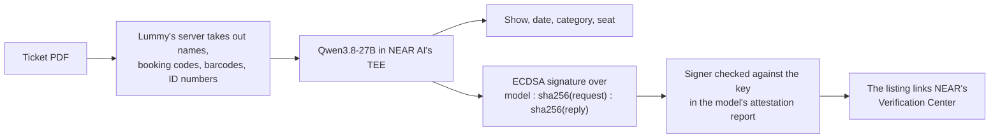

- **What leaves our server.** Only the ticket's text, with names, booking codes, barcode contents, ID numbers, emails and phone numbers taken out ([`clean.ts`](web/src/lib/tickets/clean.ts)). If anything that looks personal is left, nothing is sent and the seller fills the form in by hand.
- **What the TEE adds.** The text is read inside hardware-isolated, attested hardware: an Intel TDX machine whose NVIDIA GPUs run in confidential-computing mode. We say "hardware-isolated and attested", not "nobody can see it".
- **The receipt.** We hash the exact bytes sent and received, fetch the model's signature, recover its signer with viem, and require that signer to be a key named in the model's attestation report. The request names the model's canonical id with `x-no-aliasing`, so NEAR's gateway forwards it unchanged and the signature comes from the model's TEE, not from the gateway. A listing links [NEAR's Verification Center](https://cloud.near.ai/verify) only when both checks pass. The receipt holds hashes, never the ticket's text.
- **The GPU, asked from our server.** The attestation report carries the evidence each GPU produced for a nonce our server made up. The server sends it to NVIDIA's Remote Attestation Service and requires three things: NVIDIA's verdict, our nonce in NVIDIA's token (so the evidence is not a replay), and the token's ES384 signature by a key NVIDIA publishes ([`gpu.ts`](web/src/lib/near/gpu.ts)). The Intel TDX quote of the machine around the GPU is not checked by us: NEAR's Verification Center checks it in the reader's browser, from the link on each receipt.
- **What is kept.** A listing keeps the facts that were read and the receipt: two hashes, the signature, the signer and NVIDIA's verdict. The text sent to the model is not kept. The ticket file is, in private storage, because the buyer has to receive it. The check on lummy.id/near writes nothing.
- **Measured before it was switched on.** On 33 made-up tickets, Qwen3.8-27B with thinking off got every field right on 29. On the other 4 it left the title blank rather than invent one: 97.8% of fields right, with a median of 2.8 seconds and 31 of 31 receipts verified. Claude Haiku 5.5, which still reads other sellers' tickets, got all 231 fields right on the same set.
- **Where it lives:** [`web/src/lib/tickets/near-ai.ts`](web/src/lib/tickets/near-ai.ts) (the call and the receipt), [`web/src/lib/tickets/ai.ts`](web/src/lib/tickets/ai.ts), [`web/src/app/near/page.tsx`](web/src/app/near/page.tsx).

<table>
<tr>
<td width="50%">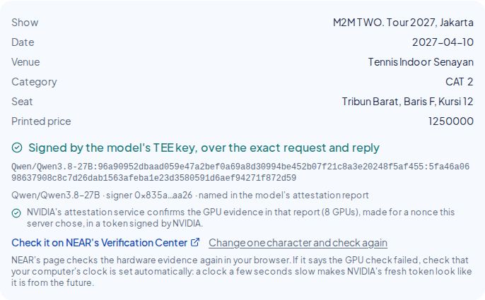<br><b>On lummy.id/near.</b> A made-up ticket read in the TEE in a few seconds, signed by the model's key, which is named in its attestation report.</td>
<td width="50%">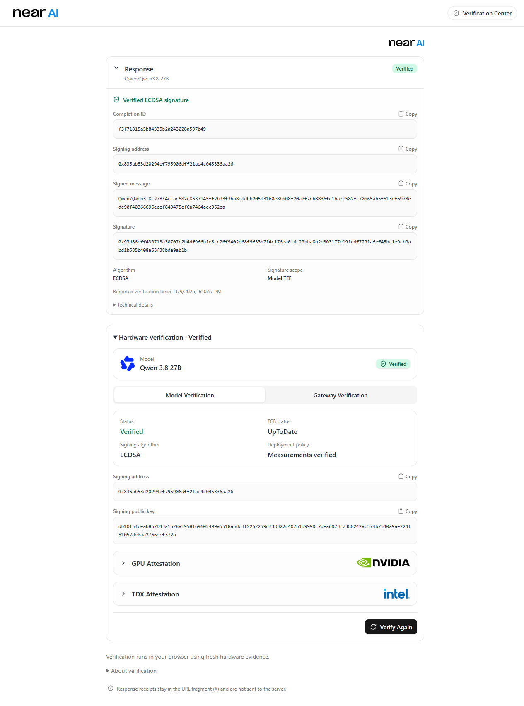<br><b>On NEAR's own page.</b> The same kind of receipt: the signature verified, and the hardware evidence (NVIDIA GPU, Intel TDX) verified in the browser.</td>
</tr>
</table>

NEAR's page checks NVIDIA's freshly issued GPU token with no allowance for clock difference. On a computer whose clock runs a few seconds slow it reports the GPU check as failed, while the same receipt passes in full once the clock is right. [lummy.id/near](https://lummy.id/near) says so next to the link.

**When NEAR AI is down.** On the morning of 10 November 2026 NEAR AI Cloud's API, its private models and its attestation service were all down for hours ([status.near.ai](https://status.near.ai)), and the page could only show an HTTP 500. Now it says the live check failed and why, and shows the same check recorded from NEAR AI earlier ([`recorded.json`](web/src/lib/near/recorded.json), made by `npm run near:record`). The recording keeps the exact request and reply, so it is checked again rather than trusted: both hashes are worked out from those bytes, the signature is recovered, and the facts are read from the signed reply. The one-character test works the same. What a recording cannot show again is the attestation: that the signer was named in the model's attestation report is what our check found when it was recorded ([`recorded.ts`](web/src/lib/near/recorded.ts)).

## Try it in 2 minutes

| | Do this | See this |
|---|---|---|
| 1 | Open [lummy.id/near](https://lummy.id/near) and pick an asset under "Pay from any chain". With a browser wallet, press **Connect a wallet** | A live quote from NEAR Intents: what you would send on that chain for a 9.50 USDC ticket, and how long it usually takes. With a wallet: what it holds on six chains and which of it covers the ticket, the one that does already picked. Nothing is held, nothing is paid, and reading moves nothing |
| 2 | Under "A ticket check you can verify", press **Check this ticket** | A made-up ticket read in NEAR AI's TEE, "Signed by the model's TEE key", the signer named in the attestation report, and NVIDIA's attestation service confirming the GPU evidence for a nonce our server chose. If NEAR AI Cloud is not answering, the page says so and shows the same check recorded earlier, checked again (a recording carries no verdict from NVIDIA) |
| 3 | Press **Check it on NEAR's Verification Center** | NEAR's page verifies the same receipt and the hardware evidence in your browser |
| 4 | Press **Change one character and check again** | The changed receipt is refused |
| 5 | Open the six links under "On chain" | The first real payment, step by step, on Basescan, the NEAR Intents explorer and Arbiscan |
| 6 | Open [that payment's receiver](https://arbiscan.io/address/0x903CE1751A2F5e8034b9A14a37b9294b8Ab58f6A#readContract) on Arbiscan, then the factory's [`receiverOf`](https://arbiscan.io/address/0x3dFc2bFFBfC17F1e5F741E0dCD04e8F24dd6b75C#readContract) with the terms it shows | The same address comes back: the terms the buyer paid against are fixed in the address itself |

Paying for real through NEAR Intents is open to the Lummy team's accounts only, so a visitor sees the quote but no deposit address.

### Without a browser

For an agent, or anyone in a terminal. Every line reads public data; only the last needs a key, and that one is yours.

| | Run this | See this |
|---|---|---|
| A | `curl -s https://lummy.id/api/near/options` | `"assets"` lists the 15 assets, `"rail":true`, and the two contracts on Arbitrum One: `"escrow":"0x68d535494bf33a6F483A945683Ab629D036d3cb3"` and `"factory":"0x3dFc2bFFBfC17F1e5F741E0dCD04e8F24dd6b75C"`. `"team":false`: you may look, not pay |
| B | `curl -s -X POST https://lummy.id/api/near/quote -H 'content-type: application/json' -d '{"originAsset":"nep141:base-0x833589fcd6edb6e08f4c7c32d4f71b54bda02913.omft.near","amount":"9500000"}'` | A live quote from NEAR Intents for USDC on Base: `"amountIn"` near `9.60`, `"amountOut":"9.5"`, `"etaSeconds"`. Nothing is held |
| C | `curl -s -X POST https://lummy.id/api/near/ticket-check -H 'content-type: application/json' -d '{"sample":"concert"}'` | A made-up ticket read in NEAR AI's TEE, in 3 to 8 seconds: `"facts"`, and a `"receipt"` with `"verified":true`, `"attested":true` and `"gpu":{"ok":true,"fresh":true,"signed":true}`. `"verifyUrl"` is NEAR's own page for that receipt. When NEAR AI is not answering, the reply carries `"recordedAt"` and `"liveError"` instead, and no `"gpu"`. Six reads in ten minutes for each visitor |
| D | `curl -s -X POST https://lummy.id/api/near/held -H 'content-type: application/json' -d '{"address":"0xd8dA6BF26964aF9D7eEd9e03E53415D37aA96045","amount":"9500000"}'` | `"held"`: for each of the nine EVM assets, that wallet's `"balance"`, what a 9.50 USDC ticket `"needs"` of it, and whether that is `"enough"` |
| E | `curl -s https://lummy.id/api/chain/history/0x435ad32a3c0844c5562365f0a12ddcf4126d7eaecc0b67290d49120b9883b181` | The team's real order of 10 November, read from the escrow's events on Arbitrum One: `Listed`, `Funded`, `HandoverMarked`, `DisputeRaised`, then `Resolved` with `"toBuyer":"9500000"`, each with its transaction hash. The [public proof page](https://lummy.id/proof/0x435ad32a3c0844c5562365f0a12ddcf4126d7eaecc0b67290d49120b9883b181) shows this same record |
| F | `git clone --recurse-submodules https://github.com/Lummy-Ticket/lummy && cd lummy/web && npm ci && npm run near:check` | `91/91 checks pass`, offline, with no keys: the receipt, NVIDIA's verdict on the GPU evidence (its nonce and its signature), which asset a wallet is offered first, real receipts recorded from NEAR AI's TEE, what the page does when NEAR AI is down or flapping, paying the deposit from the buyer's own wallet, the Verification Center link, the 1Click request, and who may pay |
| G | `npm run near:terms` | `6/6 checks pass`. It reads the terms that order's receiver carries from the contract itself, asks the factory which address those terms give (that very one), and shows that another refund address, price, deadline or seller each gives another address. A public RPC, no keys |
| H | `npm run near:held -- 0xd8dA6BF26964aF9D7eEd9e03E53415D37aA96045` (or any address) | What that wallet holds of the nine EVM assets, read from public RPCs, what a 9.50 USDC ticket would take of each, and which one the checkout would offer first. Dry quotes only: nothing is held or sent |
| I | `cd ../contracts && forge test` (needs [Foundry](https://www.getfoundry.sh)) | 147 tests pass, 33 of them on the receiver and its factory |
| J | `cd ../web && npm run near:fork` (Foundry again) | `13/13 checks pass` in about a minute: both contracts deployed on a fork of Arbitrum One with Circle's real USDC, then a payment with too much, a release to the seller, a claim refunded through the receiver, and money with no order going back by itself. Nothing leaves your machine |
| K | `NEAR_AI_API_KEY=your-key npm run near:prove` ([NEAR Builders](https://nearbuilders.org/dashboard) gives US$10 of credits) | Two made-up tickets read in the TEE with your own key: the facts, "signature and text check out: true", "signer named in the model's attestation report: true", NVIDIA's verdict on the GPU evidence, and the link to NEAR's Verification Center. About US$0.001 |

Without a key, `npm run dev` still shows a real check on `localhost:3000/near`: the one recorded from NEAR AI, verified again from its bytes, and it says the server has no key.

## How we checked it

| Check | What it covers | Result |
|---|---|---|
| `npm run near:check` (in CI) | Offline, no keys. A real ECDSA signature over `model:request_hash:response_hash` passes, and a changed hash, model, signer, text or kind of signature fails. The Verification Center link carries no ticket text. A listing links a receipt only when it was verified and attested. The 1Click request asks for the exact amount at the receiver, with refunds on the chain paid from. Only staff and the named team may pay, never a demo account. Real receipts recorded from NEAR AI's TEE: the exact request and reply kept in the repository hash to what the model's key signed, the signature recovers to that key, and one added character is refused. When NEAR AI answers with an HTTP 500, `/near` gets the recording, marked as one, and does not ask again for two minutes. NEAR's 400 "Provider failed", which it gives while a model is redeployed, is tried again; other 400s are not. Paying from the buyer's own wallet on an EVM chain sends the exact units: `transfer` to the deposit address on the token, or plain value for ETH. A wallet's balance is judged against a live quote and the gas to send it, and what can pay is offered a stablecoin first and Ethereum last. NVIDIA's verdict on the GPU evidence counts only with our nonce, unexpired, from NVIDIA's issuer and signed by a published key. A server with no NEAR AI key shows the recorded check and says so. Every error these routes send carries English. The minute cron runs for nobody without its secret | 91 of 91 |
| `npm run near:terms` | On Arbitrum One, through a public RPC: the receiver of the real order of 10 November carries its terms, the factory gives that very address for them, and a changed refund address, price, deadline or seller each gives another address | 6 of 6 |
| `forge test` in `contracts/` | The new receiver and its factory (33 tests: the two exits, the terms checked against the escrow, overpayment, late money, EIP-1271 only inside `fund`, fuzzing), plus the escrow and ledger from before | 147 of 147. The receiver: 100% of lines and functions, 91.7% of branches |
| `RUN_FORK=1 forge test --match-contract Fork` | The receiver against Circle's real USDC on a fork of Arbitrum One | 2 of 2 |
| `npm run near:fork` | The chain side through the app's own code, on that fork: a payment with too much, a release to the seller, a claim refunded through the receiver, money with no order going back by itself | 13 of 13 |
| `npm run near:app` | The whole app flow: a local server, the real 1Click API, the database and the fork. A hold and a cancel, an overpayment, one order however often it is checked, a claim refunded to the refund address. Then a payment whose buyer never looks again: with part of the money delivered a second payment is refused and the hold cannot be cancelled, and with the rest delivered the minute cron alone writes the order and the buyer is told by email | 32 of 32 |
| `npm run near:pay` | One real payment from another chain into the escrow on Arbitrum One and back | [Done 9 Nov 2026](#tried-with-real-money) |
| `npm run ai:eval -- --provider near` | 33 made-up tickets, each through the same cleaning as a real upload, then the TEE model; every request checked for names, numbers and codes that should have been taken out | 29 of 33 tickets, 97.8% of fields, 31 of 31 receipts |
| Slither (Trail of Bits), in CI | The new receiver triaged with the rest in [`contracts/SECURITY-ANALYSIS.md`](contracts/SECURITY-ANALYSIS.md). CI fails on any untriaged medium or high finding | 21 new findings triaged, none a real issue |

Anyone can run `near:check`, `near:terms`, `near:held` and `forge test` with no keys, and `near:fork` with Foundry: on 11 November it passed in under a minute from an environment with nothing but Foundry and Node. The app and payment runs need our keys or the database, so the team runs them. The results above are from 9 to 11 November 2026.

## Contracts

**On Arbitrum One (chain ID 42161), new this week**

| Contract | Address | What it does |
|---|---|---|
| `LummyEscrow` | [`0x68d535494bf33a6F483A945683Ab629D036d3cb3`](https://arbiscan.io/address/0x68d535494bf33a6F483A945683Ab629D036d3cb3#code) | The same escrow as on Arbitrum Sepolia, deployed fresh: Circle's USDC, a 48-hour claim window after the show, at most 25 USDC an order |
| `LummyIntentFactory` | [`0x3dFc2bFFBfC17F1e5F741E0dCD04e8F24dd6b75C`](https://arbiscan.io/address/0x3dFc2bFFBfC17F1e5F741E0dCD04e8F24dd6b75C#code) | Computes each order's `LummyIntentReceiver` address, and deploys and funds it |

Both have verified source on Arbiscan and are not proxies. Neither takes a fee. Money in the escrow can only go to a listing's buyer or seller, and money at a receiver only into its listing or back to its refund address.

**On Arbitrum Sepolia (chain ID 421614), from before the hackathon:** [`LummyEscrow`](https://sepolia.arbiscan.io/address/0x6830Db86283157E4cB80b0615d4c51381A0C25Dd#code) with test USDC, and [`LummyLedger`](https://sepolia.arbiscan.io/address/0xe454cbc81916E9BE1e6A768715134568FCEE8b0E#code), the public record of QRIS orders. Details: [`contracts/README.md`](contracts/README.md).

## Architecture

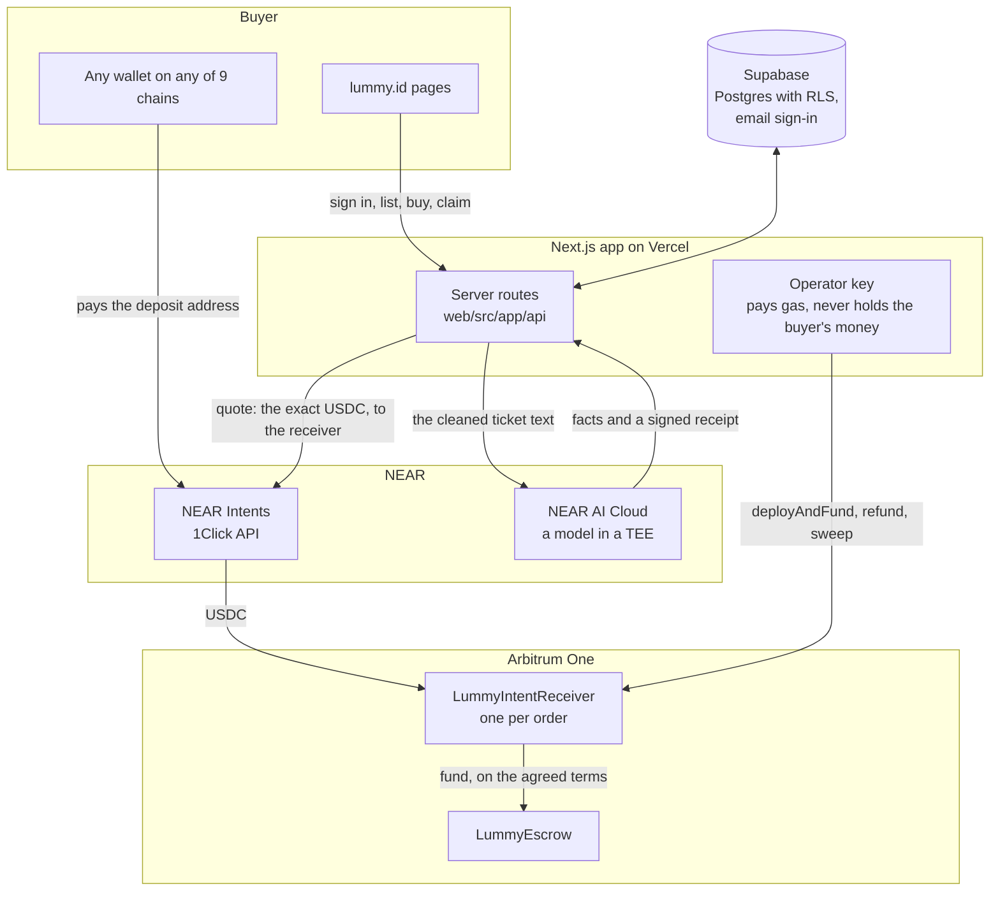

The database decides; the chain holds the money. Tickets stay off chain: they are the organiser's PDFs, not NFTs.

**Why the escrow stays on Arbitrum.** It was already built and tested there: Circle's native USDC with ERC-3009, the escrow's own 76 tests with fuzzing and invariant runs, and a testnet deployment the app has used since October. NEAR Intents delivers to any chain, so it brings the money to the escrow from 9 chains, NEAR itself included, without moving the escrow. Rewriting it as a NEAR contract in Rust this week would have meant shipping an untested escrow.

## How an order settles

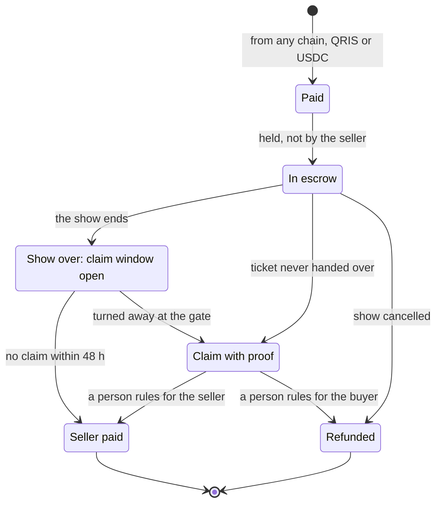

A ruling can also split the money. The clock settles an order, not a button: there is no "I got in" confirmation to fake. A refund on an order paid from another chain goes to the refund address the buyer gave before paying, as USDC on Arbitrum One.

## Before this hackathon

Everything before the tag `pre-hackathon` (9 November 2026) existed already and is not part of this entry:

- **Lummy, since July 2026:** escrow for concert ticket resale in Indonesia. Rupiah by QRIS through Xendit in test mode: the licensed provider holds the money until the show, and every paid order is recorded on `LummyLedger`. Ticket checks: each barcode held by one listing only, edited PDFs sent to a person, the show and seat read by Claude after personal data is taken out. Claims ruled by a person.
- **Arbitrum Founder House Singapore, 23 to 25 October 2026:** we added the checkout for shows abroad, in test USDC from the buyer's own wallet, into `LummyEscrow` on Arbitrum Sepolia. We submitted it, and were not a finalist. The tag `founder-house-start` marks where that work began, and the [demo video from then](https://youtu.be/090tOYfTQ4I) shows the product as it was.

<details>
<summary><b>Screens of the product</b></summary>

<table>
<tr>
<td width="50%">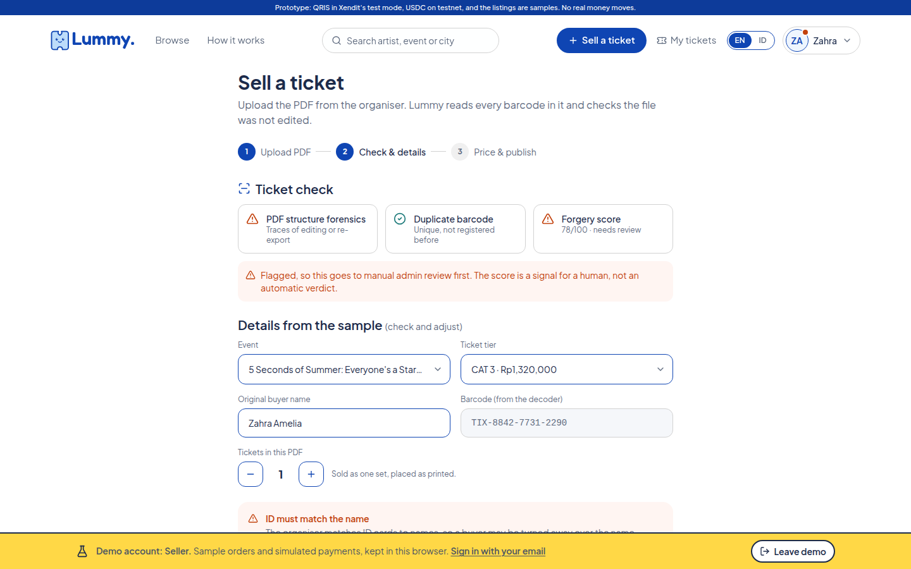<br><b>Every ticket is checked first.</b> An edited sample PDF is flagged for a person; a barcode already on sale is refused.</td>
<td width="50%">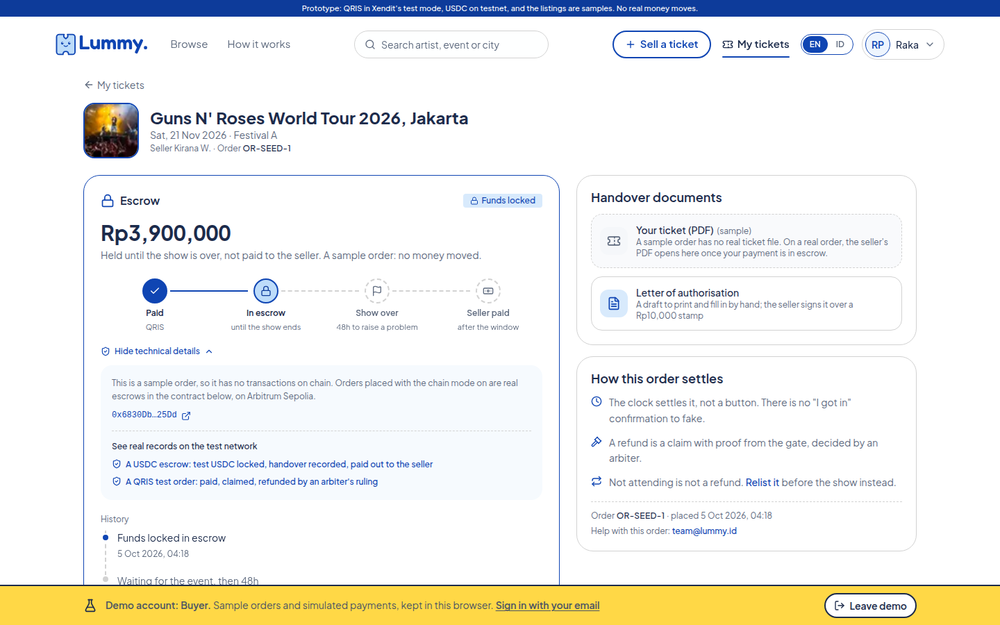<br><b>The money waits for the show.</b> The order page shows where the money is, when it pays out, and the handover documents.</td>
</tr>
<tr>
<td>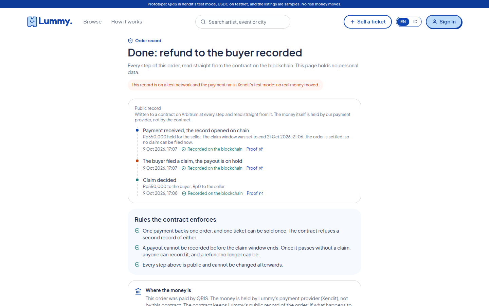<br><b>Every paid order is a public record.</b> The proof page reads LummyLedger on Arbitrum: paid, claimed, ruled, refunded.</td>
<td>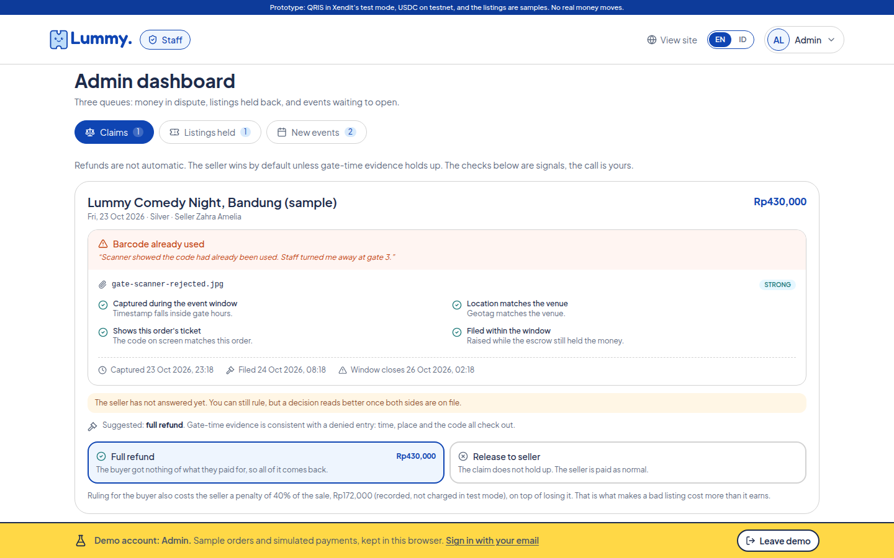<br><b>A person rules on claims.</b> The evidence checks are signals for staff, not verdicts.</td>
</tr>
</table>

</details>

## Built with

- **App:** Next.js 16 and TypeScript on Vercel, Supabase (Postgres with row-level security, email sign-in), viem.
- **Contracts:** Solidity 0.8.28 with Foundry and OpenZeppelin, Circle's USDC, Slither in CI.
- **NEAR:** NEAR Intents through the 1Click API (quote, deposit, status). NEAR AI Cloud: Qwen3.8-27B in a TEE, its signature endpoint and its attestation report.
- **AI tools:** most of the code was written with Claude Code (Anthropic), directed and reviewed by the team, and Claude drafted this README. Claude Haiku 5.5 reads tickets for sellers outside the team.

## Not done yet

- Real payments through NEAR Intents are for the team's accounts only, at most 25 USDC an order. The contracts are unaudited.
- On Arbitrum One the seller's share goes to a team wallet: sellers sign in with an email and have no wallet yet.
- The listings on shows abroad are the team's samples.
- The TEE read runs for the team's accounts. Other sellers' tickets are still read by Claude Haiku, after the same cleaning.
- NEAR AI's response times vary: 1 to 8 seconds this week, with the odd stall of 20 to 30 seconds. A try is cut at 12 seconds and sent again.
- There is no NEAR smart contract. NEAR is how the money arrives and where the ticket is read.
- Paying from a connected wallet in one confirmation was added on 11 November. Its parts are checked, the reading against real wallets, but it has not yet carried a real payment.
- We do not verify the Intel TDX quote ourselves. NEAR's Verification Center does, in the reader's browser.

<details>
<summary><b>Repo map</b></summary>

| Path | What it is |
|---|---|
| [`web/`](web) | The Next.js app in TypeScript: buyer, seller and staff pages |
| [`web/src/lib/near`](web/src/lib/near) | NEAR Intents (1Click), who may pay, the made-up tickets for /near |
| [`web/src/lib/tickets`](web/src/lib/tickets) | The ticket checks: barcodes, the cleaner, the AI step, the NEAR AI call and its receipt |
| [`web/src/lib/payments`](web/src/lib/payments) | Payments from any chain, QRIS through Xendit, and the USDC checkout |
| [`web/src/lib/chain`](web/src/lib/chain) | Contract access with viem, on the server and in the browser |
| [`web/src/app/api`](web/src/app/api) | Server routes: listings, orders, payments, claims, the ticket checks, /near |
| [`web/scripts`](web/scripts) | The checks above, and the local and fork rehearsals |
| [`contracts/`](contracts) | Solidity and Foundry: `LummyEscrow`, `LummyLedger`, `LummyIntentReceiver`, tests, deploy scripts |
| [`supabase/`](supabase) | The Postgres schema, row-level security and its tests, email templates |

</details>

<details>
<summary><b>Run it locally</b></summary>

Node 22 and [Foundry](https://www.getfoundry.sh). Each line runs from the repository root:

```bash
cd web && npm ci && npm run near:check    # the NEAR checks, offline
cd contracts && git submodule update --init --recursive && forge test
cd web && npm run dev                     # the app on localhost:3000, on sample data
cd web && npm run chain:local             # Anvil, a deploy, and four escrow cycles
```

Without environment variables the app runs on its sample catalogue and sample accounts. [`web/.env.example`](web/.env.example) lists what a deploy sets, the NEAR keys included. Code comments are in English and Indonesian.

</details>

> [!NOTE]
> This repository is a public mirror of our working repository. It holds the app, the database schema and the contracts, with their full commit history. Internal notes, plans and partner documents stay private, so a few links in code comments and commit messages point to files that are not here.

## Team and contact

- Zahra Sasongko, CEO
- Luthfi Hadi, CTO ([@luthfidi](https://github.com/luthfidi))
- Joanita Timbin Panggalo, COO

Contact: [team@lummy.id](mailto:team@lummy.id). More at [github.com/Lummy-Ticket](https://github.com/Lummy-Ticket).

## License

All rights reserved: see [LICENSE](LICENSE). You may read the code and run its checks to judge this entry. For anything else, write to [team@lummy.id](mailto:team@lummy.id).
