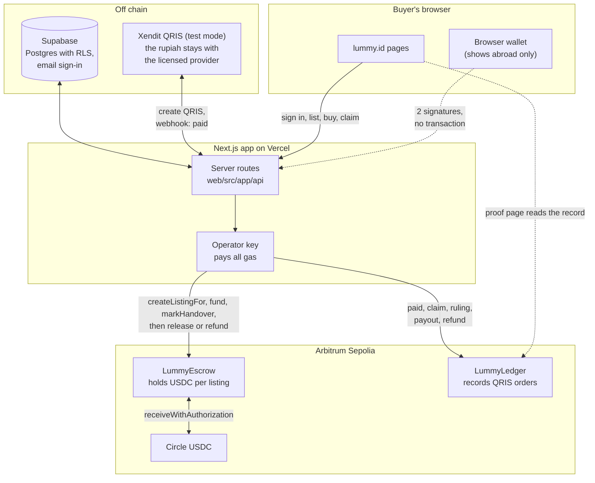

# Lummy

**Escrow for concert ticket resale in Indonesia: the buyer's money is held until 48 hours after the show.** Live at [lummy.id](https://lummy.id).

> [!IMPORTANT]
> **Status (October 2026):** a working prototype. USDC is test USDC on Arbitrum Sepolia, QRIS runs in Xendit's test mode, so no real money moves. Not launched: no users and no revenue yet. Every listing on the site is a sample.

- **Shows in Indonesia:** the buyer pays rupiah by QRIS through Xendit, a licensed payment provider. The rupiah stays with Xendit; every step of the order is recorded on Arbitrum Sepolia.
- **Shows abroad:** the buyer pays USDC from their own wallet into our escrow contract on Arbitrum, with two signatures and no gas.
- **Every ticket is checked before it goes on sale:** each barcode is read and stored as a keyed hash, so a barcode can be sold once; edited PDFs are flagged for a person. AI only fills in the show, category and seat from the ticket text, with personal data removed first. It does not decide whether a ticket is real.
- Users sign in with email. A wallet only appears when paying for a show abroad.

> [!NOTE]
> This repository is a public mirror of our working repository. It holds the app, the database schema and the contracts, with their full commit history. Internal notes, plans and partner documents stay private, so a few links in code comments and commit messages point to files that are not here.

## Built at Arbitrum Founder House

The git tag `founder-house-start` marks the start of Arbitrum Founder House Singapore (23 October 2026, 08:53 WIB). Everything before it existed already. To see the work done at the event:

```bash
git log founder-house-start..HEAD
```

or on GitHub: [compare `founder-house-start...main`](https://github.com/Lummy-Ticket/lummy/compare/founder-house-start...main).

**What we built: USDC checkout from the buyer's own wallet, for shows abroad.**

1. The buyer picks a ticket for a show priced in USDC and connects a browser wallet (MetaMask, Rabby or any EIP-1193 wallet).
2. The server holds the seats for 10 minutes and returns two typed messages, bound to one on-chain listing.
3. The wallet signs twice, with no transaction and no ETH: an **ERC-3009** `ReceiveWithAuthorization` on Circle's USDC, and an **EIP-712** `Fund` intent bound to that listing, buyer, amount, nonce and deadline.
4. The server checks both signatures against the paying wallet. Then **our operator pays the gas** and sends `createListingFor`, `fund` and `markHandover`: the USDC is now locked in **LummyEscrow** until the claim window after the show closes.
5. The ticket page shows the paying wallet and links each transaction on Arbiscan. If the order cannot be written after funding, the USDC goes straight back to the wallet on chain.

Guards: a "Testnet, not real money" label, sign-in required, at most 3 open USDC orders per wallet, a rate limit per account, and a switch that turns the rail off without a deploy. The QRIS path for shows in Indonesia did not change, and neither did the contracts: the escrow was designed for this from the start.

Where it lives: [`web/src/lib/payments/usdc.ts`](web/src/lib/payments/usdc.ts) (server), [`web/src/components/checkout/UsdcPanel.tsx`](web/src/components/checkout/UsdcPanel.tsx) and [`web/src/lib/chain/wallet.ts`](web/src/lib/chain/wallet.ts) (wallet side), [`web/scripts/usdc-check.ts`](web/scripts/usdc-check.ts) (the end-to-end check). We also replaced the made-up catalogue with real shows in Jakarta and abroad, with a source for every price.

Limits today: the seller's USDC payout goes to a simulated seller address, because sellers have no wallet yet in our email-first model. Listing a ticket for a USDC show is closed for now; the sample listings were added by the team. There is no service fee on USDC orders while on testnet.

## Try it in 2 minutes

| Step | What you need |
|---|---|
| 1. Open a USDC show: [lummy.id/events/ev-bbw-2026](https://lummy.id/events/ev-bbw-2026) (Binance Blockchain Week, Bangkok). Prices read in USDC, with the testnet label. | Nothing |
| 2. Open a public proof page: [an example QRIS test order](https://lummy.id/proof/0x92b4028867b6babeb33c6f262bdbdb04f2396faf067b57d31a9acf6778948691) with a payment, a claim and a full-refund ruling, read straight from LummyLedger, with Arbiscan links. It shows "Reading the contract..." for a moment. | Nothing |
| 3. Pay by QRIS in test mode: open a show in Indonesia, such as [5 Seconds of Summer, Jakarta](https://lummy.id/events/ev-5sos-jakarta), pick a listing, tick that you understand the gate checks your ID card against the name on the ticket (this show's rule, from its ticket seller's terms), and press Pay. A QRIS code opens; press **Simulate payment (test mode)**. Your ticket page opens; once our operator has recorded the order on LummyLedger, it shows the steps and links to the order's own proof page. | An email to sign in. No wallet |
| 4. Pay in USDC: back on the [USDC show](https://lummy.id/events/ev-bbw-2026), pick a listing (the cheapest sample was 9.50 test USDC on 23 Oct), choose "USDC from your wallet", connect, then sign twice. | An email to sign in, and a browser wallet with test USDC from [Circle's faucet](https://faucet.circle.com) (choose Arbitrum Sepolia). No ETH |

The test QRIS code cannot be paid by a real banking app, and the test USDC has no value. What we do and do not promise is spelled out at [lummy.id/how-it-works](https://lummy.id/how-it-works).

## Contracts on Arbitrum Sepolia (chain ID 421614)

| Contract | Address | What it does |
|---|---|---|
| `LummyEscrow` | [`0x6830Db86283157E4cB80b0615d4c51381A0C25Dd`](https://sepolia.arbiscan.io/address/0x6830Db86283157E4cB80b0615d4c51381A0C25Dd#code) | Holds a buyer's USDC per listing until the claim window after the show closes, then pays the seller, refunds the buyer, or splits it on a ruling. Money can only go to that listing's buyer or seller, and once the window closes without a dispute anyone can release it to the seller, even with our backend down. |
| `LummyLedger` | [`0xe454cbc81916E9bE1e6A768715134568FCEE8b0E`](https://sepolia.arbiscan.io/address/0xe454cbc81916E9bE1e6A768715134568FCEE8b0E#code) | Records each rupiah (QRIS) order's life on chain: paid, claim, ruling, payout, refund. It holds no money and no personal data; each order gets a public proof page. |
| USDC (Circle) | [`0x75faf114eafb1BDbe2F0316DF893fd58CE46AA4d`](https://sepolia.arbiscan.io/token/0x75faf114eafb1BDbe2F0316DF893fd58CE46AA4d) | Circle's native USDC on Arbitrum Sepolia, not a mock. Its ERC-3009 support is what lets the buyer pay with signatures alone. |

Both Lummy contracts have verified source on Arbiscan and Sourcify. Both refuse a ticket barcode commitment that was already sold. Details: [`contracts/README.md`](contracts/README.md).

## Architecture



The database decides; the chain holds the money or keeps the record. Tickets, ID cards and rupiah stay off chain: tickets are not NFTs, and we store no ID cards.

**Why on chain, and why Arbitrum**

- **The money rules do not depend on trusting us.** USDC sits in LummyEscrow, not with us, and anyone can release it to the seller once the claim window closes.
- **Every order step is a public record.** Buyers, sellers and promoters can check it on the proof page and on Arbiscan. In Indonesia crypto may not be used as payment, so there the rupiah stays with Xendit and the chain only records.
- **Arbitrum:** Circle's native USDC with ERC-3009 (gasless for the buyer), settlement to Ethereum, and gas low enough to record every step of every order (one escrow cycle used 370,000 to 520,000 gas; we estimated about Rp400 to Rp800 per order on Arbitrum One in September 2026).

## How we check it

| Suite | What it covers | Last result |
|---|---|---|
| `forge test` in `contracts/` | Both contracts: the six escrow outcomes, the claim window, signatures, barcode commitments, access, reentrancy, plus fuzzing and invariant runs (the escrow balance always equals its books, the operator never receives funds) | 114 of 114 pass |
| `npm run usdc:check` | The USDC checkout end to end on Arbitrum Sepolia: forged signatures, another account sending the buyer's signatures, the wallet paying exactly the price, the listing funded on chain by that wallet, a purchase through the pages with a wallet injected into the browser, a cancelled show that refunds the wallet in full, and claims on USDC orders with a full or a partial ruling (including a ruling whose reply was lost), checked on the order, the escrow, the wallet and the proof page | 57 of 57 pass |
| `npm run payments:check` | QRIS in Xendit's test mode end to end: one order per payment however often the webhook arrives, forged webhooks refused, seats given back on cancel or expiry, the order, a claim and a ruling recorded on LummyLedger, and a cancelled show refunded on the record | 62 of 62 pass |
| Slither (Trail of Bits), in CI on every push | Both contracts, twice: as deployed, and with an analysis-only copy of one OpenZeppelin guard that Slither 0.11.6 cannot parse. Every finding is triaged in [`contracts/SECURITY-ANALYSIS.md`](contracts/SECURITY-ANALYSIS.md); CI fails on any untriaged medium or high finding | 12 findings triaged, none a real medium or high |

Also: row-level security tests in [`supabase/tests`](supabase/tests), Playwright browser tests in [`web/e2e`](web/e2e), and more scripted checks in [`web/scripts`](web/scripts). Anyone can run `forge test`. The `usdc:check` and `payments:check` runs need our testnet keys and database, so the team runs them; the results above are from 24 October 2026.

## Repo map

| Path | What it is |
|---|---|
| [`web/`](web) | The Next.js app in TypeScript: buyer, seller and staff pages |
| [`web/src/app/api`](web/src/app/api) | Server routes: listings, orders, QRIS and USDC payments, claims, the gate, the ticket checks |
| [`web/src/lib/payments`](web/src/lib/payments) | QRIS through Xendit, and the USDC checkout |
| [`web/src/lib/chain`](web/src/lib/chain) | Contract access with viem, on the server and in the browser |
| [`web/scripts`](web/scripts) | The end-to-end checks and the local chain cycles |
| [`contracts/`](contracts) | Solidity and Foundry: `LummyEscrow`, `LummyLedger`, tests, deploy scripts |
| [`supabase/`](supabase) | The Postgres schema, row-level security and its tests, seed data, email templates |

## Run it locally

Node 22 and [Foundry](https://www.getfoundry.sh). Each line runs from the repository root:

```bash
cd web && npm install && npm run dev      # the app on localhost:3000, on sample data
cd contracts && git submodule update --init --recursive && forge test
cd web && npm run chain:local             # Anvil, a deploy, and four escrow cycles: release, refund, dispute, a show tomorrow
cd web && npm run chain:fork              # a rehearsal on an Arbitrum Sepolia fork with Circle's USDC, no faucet
```

Without environment variables the app runs on its sample catalogue and sample accounts. [`web/.env.example`](web/.env.example) lists what a deploy sets (Supabase, Xendit, the operator key, the AI provider). Code comments are in English and Indonesian.

## Team and contact

- Zahra Sasongko, CEO
- Luthfi Hadi, CTO ([@luthfidi](https://github.com/luthfidi))
- Joanita Timbin Panggalo, COO

Contact: [team@lummy.id](mailto:team@lummy.id). Concert news: [@lummy.magazine](https://www.instagram.com/lummy.magazine/) on Instagram. More at [github.com/Lummy-Ticket](https://github.com/Lummy-Ticket).

## License

All rights reserved. The code is public to read, not licensed for reuse.
